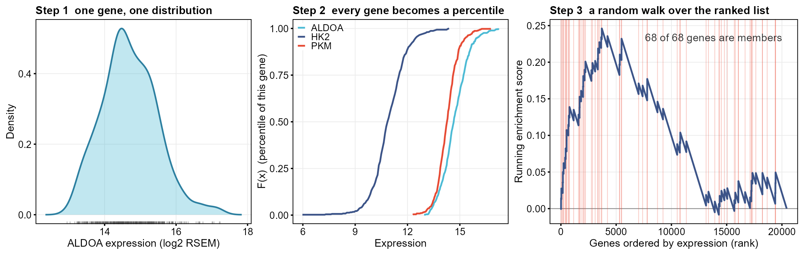
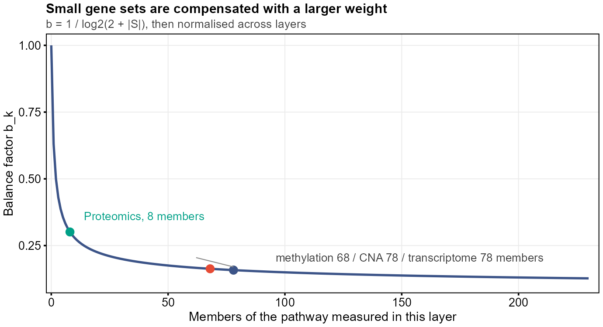
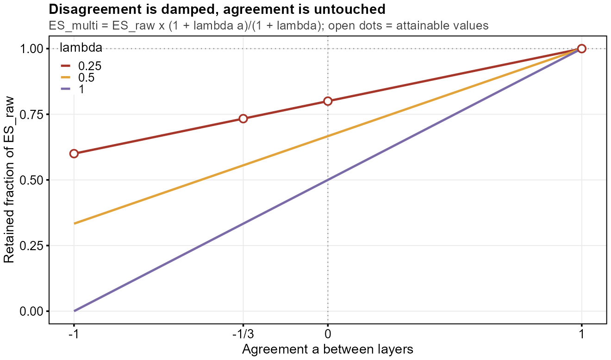

# 从 GSVA 到 moGSVA：把"通路活性"算清楚

单样本的通路打分怎么做？四个组学层又怎么揉成一个数？这篇文章从 KDE 讲到加权融合，全程配伪代码，顺便把 `mogsva.R` 和它吐出来的十张表拆开讲一遍，尽量让公式看起来不像天书。

> 面向：生物信息 / 计算生物学方向的研究生　｜　预计阅读 25 分钟

---

## 目录

1. [一个让审稿人皱眉的问题](#1-一个让审稿人皱眉的问题)
2. [GSVA 第一步：给每个基因配一把自己的尺子](#2-gsva-第一步给每个基因配一把自己的尺子)
3. [GSVA 第二步：把表达量换成"分位数"](#3-gsva-第二步把表达量换成分位数)
4. [GSVA 第三步：在排序表上走一段随机游走](#4-gsva-第三步在排序表上走一段随机游走)
5. [把它拼起来：GSVA 完整伪代码](#5-把它拼起来gsva-完整伪代码)
6. [从一层到四层：三个绕不过去的坑](#6-从一层到四层三个绕不过去的坑)
7. [moGSVA：五步把四个组学揉成一张表](#7-mogsva五步把四个组学揉成一张表)
8. [三个容易被忽略的实现细节](#8-三个容易被忽略的实现细节)
9. [真的跑一遍：mogsva.R 逐行读](#9-真的跑一遍mogsvar-逐行读)
10. [结果文件夹里那十张表怎么读](#10-结果文件夹里那十张表怎么读)
11. [写在最后](#11-写在最后)

---

## 1. 一个让审稿人皱眉的问题

你做完转录组差异分析，兴冲冲地写"糖酵解通路在肿瘤中显著上调"。审稿人回了一句：

> 这个通路活性在**单个样本**里是多少？我想把它和分级、生存做个关联。

这时候经典 GSEA 就有点尴尬了。GSEA 的富集分数（ES）是**队列级**的：它先按"两组之间的差异程度"把基因排个序，再看通路成员是不是扎堆排在两端。换句话说，它回答的是"这*一组*样本里，这条通路整体偏上还是偏下"，而不是"1 号病人这条通路有多活跃"。

打个比方：GSEA 告诉你"这个班的数学平均分比隔壁班高"，但你需要的是"每个学生的数学单科排名"。GSVA（Gene Set Variation Analysis，Hänzelmann 等，2013）就是干这件事的——**把基因 × 样本的矩阵，变成通路 × 样本的矩阵**，一行一条通路，一列一个样本，格子里是这条通路在这个样本里的活性分数。

它的核心思想只有一句话：*对每个样本，把基因按"相对活跃程度"排序，然后看某条通路的成员是不是挤在榜单前列*。听起来很简单，但"相对活跃程度"这四个字里藏着三个技术决定，我们一个一个拆。

---

## 2. GSVA 第一步：给每个基因配一把自己的尺子

先问一个朴素的问题：基因 A 表达量 12.3，基因 B 表达量 3.1，谁更"高"？

这个问题没法回答。因为不同基因的表达量根本不在一个尺度上：看家基因动辄 log2 值 14，转录因子可能只有 4。拿绝对值互相比较，等于用身高去比体重。

正确的问法是：**基因 A 的 12.3，在它自己那 460 个样本的分布里，处于什么位置？** 如果它平时就在 12 附近晃，那 12.3 平平无奇；如果它平时只有 8，那 12.3 就是暴涨。

所以要给每个基因估计一条**累积分布函数**（CDF）。GSVA 用高斯核密度估计（KDE）来做：

$$
\hat{F}_i(x) \;=\; \frac{1}{N h}\sum_{m=1}^{N}\Phi\!\left(\frac{x-x_{im}}{h}\right)
$$

这里 <i>x</i><sub><i>im</i></sub> 是基因 <i>i</i> 在第 <i>m</i> 个样本里的表达值，<i>N</i> 是样本数（这里是 460），Φ 是标准正态的累积分布，<i>h</i> 是带宽。直观理解：**把每个样本的表达值当成一个小山包，460 个小山包叠起来，就是这条基因的"分布地形"**。



*图 1｜左：单个基因（ALDOA）在 460 个肿瘤中的表达分布与核密度曲线。中：三个糖酵解基因各自的累积分布——每条曲线都是这个基因专属的"尺子"。右：一个样本里，按表达量排序后沿基因列表做随机游走的轨迹，红色竖线是糖酵解通路成员的位置。*

注意一个容易被忽略的点：**KDE 是在"样本维度"上做的，不是基因维度**。对每个基因 <i>i</i>，用它在 <i>N</i> 个样本里的 <i>N</i> 个观测值估计一条曲线。这就是为什么 GSVA 需要足够多的样本：460 个样本估一条曲线还算稳，10 个样本就纯属玄学了。

```text
# 伪代码 1：为每个基因估计它自己的分布
for gene i in all_genes:
    x[1..N] = expression of gene i across N samples
    h = bandwidth(x)                      # 高斯核带宽，常用经验法则
    F_i = function(v):
        return mean( pnorm((v - x) / h) )  # N 个样本的平均
    store F_i
```

---

## 3. GSVA 第二步：把表达量换成"分位数"

有了尺子，就能把每个表达值翻译成一个 0 到 1 之间的"百分位"：

$$
z_{ij} \;=\; \hat{F}_i(x_{ij})
$$

<i>z</i><sub><i>ij</i></sub> = 0.97 的意思是：基因 <i>i</i> 在样本 <i>j</i> 里的表达，高于该基因在所有样本中的 97%。这样一来，**上万个基因 × 460 个样本，全部被压到了同一个 0–1 的尺度上**，高表达的看家基因和低表达的转录因子终于可以同台竞技了。

实际实现里还有一个"秩变换"的细节：对每个样本 <i>j</i>，把 <i>z</i><sub>1<i>j</i></sub>, <i>z</i><sub>2<i>j</i></sub>, … 再排一次序。GSVA 默认走的是秩（rank），而不是原始 <i>z</i> 值。为什么？两个好处：

1. **抗异常值**。一个极端高表达的样本不会把整条游走曲线带跑偏。
2. **跨样本可比**。不管这个样本整体表达偏高还是偏低，比的都是"在这一列里的相对位置"。

到这里，每个样本都变成了一张**排行榜**：榜首是"在这个样本里相对最活跃"的基因，榜尾是最沉默的。

---

## 4. GSVA 第三步：在排序表上走一段随机游走

现在可以打分了。拿一条通路 <i>S</i>（比如糖酵解，68 个成员，在 mRNA 层里全都能测到），在某个样本的排行榜上从上往下扫：

- 遇到一个**通路成员**，就往上跳一步，跳多高取决于它有多"靠前"（|<i>z</i>|<sup><i>p</i></sup>）；
- 遇到一个**非成员**，就往下掉一小步。

写成公式就是标准的加权 Kolmogorov–Smirnov 型统计量：

$$
\mathrm{ES}^{(S)}_{j} \;=\; \max_{r}\left[\;
\sum_{\substack{i\in S\\ \mathrm{rank}_j(i)\le r}} \frac{|z_{ij}|^{p}}{N_R^{+}}
\;-\;
\sum_{\substack{i\notin S\\ \mathrm{rank}_j(i)\le r}} \frac{1}{N-N_H}
\;\right]
$$

几个符号：<i>N</i> 是基因总数，<i>N</i><sub><i>H</i></sub> = |<i>S</i>| 是通路成员数，<i>p</i> 通常取 1（也可以调），<i>N</i><sub><i>R</i></sub><sup>+</sup> = Σ<sub><i>i</i>∈<i>S</i></sub> |<i>z</i><sub><i>ij</i></sub>|<sup><i>p</i></sup> 是归一化常数，保证"上跳"的总高度恰好等于 1，而"下落"的总深度也等于 1。这样曲线一定从 0 出发、在终点回到 0。

**取 max 就是 ES。** 曲线在榜单前段冲高，说明通路的活跃成员扎堆在前面，这条通路在本样本里"上调"，ES 为正；反之曲线一路下探，ES 为负。也有实现取 max − min 的形式，两者只是对"双向富集"的定义略有差异。

看图 1 右格：这条糖酵解的曲线在排名约 4000 处爬到 0.24，然后慢慢回落——说明成员确实偏向前段，但不算极端集中。这就是这个样本里糖酵解的"活性分"。

```text
# 伪代码 2：单个样本、单条通路的 GSVA 打分
def gsva_score(sample_j, pathway_S):
    z = [ F_i(x[i][j]) for i in all_genes ]      # 第二步：转成百分位
    order = argsort_desc(z)                       # 按活跃度从高到低排
    N  = len(order);  Nh = len(pathway_S)
    NR = sum( abs(z[i])**p  for i in pathway_S )  # 上跳的总高度归一化

    walk = 0;  es_max = 0;  es_min = 0
    for g in order:
        if g in pathway_S:
            walk += abs(z[g])**p / NR             # 成员：上跳
        else:
            walk -= 1.0 / (N - Nh)                # 非成员：下滑
        es_max = max(es_max, walk)
        es_min = min(es_min, walk)
    return es_max          # 或 es_max - es_min
```

---

## 5. 把它拼起来：GSVA 完整伪代码

```text
# 伪代码 3：GSVA 整体流程
def GSVA(X, pathways):                 # X: genes x samples
    for i in all_genes:
        F[i] = KDE( X[i, :] )          # 步骤 1：每个基因一条分布

    for j in all_samples:
        z[:, j] = [ F[i]( X[i, j] ) for i in all_genes ]    # 步骤 2：百分位
        rank[:, j] = rank( z[:, j] )                        #         秩变换

    for S in pathways:                                      # 步骤 3：逐通路
        for j in all_samples:
            ES[S, j] = random_walk_ES( rank[:, j], S )
    return ES                                               # pathways x samples
```

复杂度大概是 <i>O</i>(<i>G</i> · <i>N</i>) 估分布 + <i>O</i>(<i>P</i> · <i>N</i> · <i>G</i> log <i>G</i>) 排序扫描（<i>G</i> 基因、<i>N</i> 样本、<i>P</i> 通路）。460 个样本、2 万个基因、335 条通路上跑一遍，单机几分钟量级——完全可以接受。

> **小结一下 GSVA 的三层设计：** KDE 解决"不同基因尺度不可比"，百分位解决"不同样本整体水平不可比"，随机游走解决"如何把整条通路的分布偏移压缩成一个数"。三层各司其职，缺一层都会出问题。

---

## 6. 从一层到四层：三个绕不过去的坑

现在问题来了：如果你手上不只有 mRNA，还有拷贝数变异（CNA）、DNA 甲基化、蛋白表达——四个组学层，怎么合并成"一条通路的活性"？

最朴素的想法是把四个矩阵上下摞成一个超级矩阵，然后直接跑一次 GSVA。这就是**拼接池化（pooled）**，也是很多论文默认的做法。它的问题是致命的：

### 坑一：量纲

CNA 是相对拷贝数（约 -2 到 +2 的连续值），甲基化是 0–1 的 beta 值，mRNA 是 log2 RSEM，蛋白是 log2 比值。把它们的数值混在一起估 KDE，等于把摄氏度、华氏度和开尔文倒在同一个温度计里——**分布估计会被数值范围最大的那层彻底主导**。

### 坑二：覆盖

同一条通路，四层的成员数完全不同。以这份数据为例（只统计该层真正测到的成员）：CNA 层一条通路中位 78 个成员，甲基化 69 个，转录组 78 个，而蛋白层在有覆盖的 158 条通路里中位只有 15 个——因为蛋白组总共才测了 181 个蛋白。拼接之后，"成员多"的层天然在随机游走里占更大权重。

### 坑三：冲突

四层经常互相打架。拷贝数扩增了，mRNA 却因为甲基化沉默而下降，蛋白又因为翻译效率变化而不变——这不是噪声，这是**真实的调控信息**。可惜简单平均会把方向相反的信号抵消成"零活性"，把一个"多层互相矛盾"的样本伪装成"这条通路很平静"。

> **这三坑正是 moGSVA 的设计动机。** 它的应对策略分别是：层内估计（避免量纲污染）、特征数平衡权重（缓解覆盖不均）、跨层一致性奖励（把冲突显式建模，而不是平均掉）。

---

## 7. moGSVA：五步把四个组学揉成一张表

### 7.1 第一步：输入结构与层内标准化

输入不再是"基因 × 样本"，而是**（特征, 层）二元组 × 样本**：

$$
X \in \mathbb{R}^{(N_1+N_2+\cdots+N_K)\times M},\qquad
\text{feature} = (\,\text{gene}_i,\; \text{layer}_k\,)
$$

每个特征带着自己的"组学身份证"。这一条看似只是数据格式，实际上决定了后面所有步骤能不能做到"层内独立"。

### 7.2 第二步：层内估计分布，层内打分

这一步和 GSVA 完全一样，唯一的差别是**严格限定在同一层内**：

$$
\hat{F}_{i}^{(k)}(x)=\frac{1}{M h_k}\sum_{m=1}^{M}\Phi\!\left(\frac{x-x_{im}^{(k)}}{h_k}\right),
\qquad
\mathrm{ES}^{(S)}_k(j)=\text{KS-walk}\big(\text{rank}(z^{(k)}_{\cdot j}),\, S_k\big)
$$

甲基化的特征只在甲基化的特征群里估分布，蛋白只在蛋白里估。量纲问题从源头上被切断了——这就是它与"拼接池化"最本质的区别。

注意下标的细节：通路 <i>S</i> 在第 <i>k</i> 层里只取**这一层测得到的成员**，记作 <i>S</i><sub><i>k</i></sub>。某层完全没覆盖这条通路时，<i>S</i><sub><i>k</i></sub> = ∅，这一层直接跳过（结果文件里 `skipped` 列标的就是这件事）。

### 7.3 第三步：按"成员数"给每层配权重

如果直接取四层平均，蛋白层会因为只测了 181 个蛋白而在每条通路里"话语权很小"——但它的成员数少，本来统计上就更不稳。**特征数平衡**的思路是：成员越少，给越大的补偿权重。

$$
b_k=\frac{1}{\log_2\!\left(2+|S_k|\right)},
\qquad
w_k=\frac{b_k}{\sum_{k'\in K(S)} b_{k'}}
$$

分母里的 <i>K</i>(<i>S</i>) 是这条通路实际有覆盖的层集合，所以权重在每条通路内部归一化，Σ<sub><i>k</i></sub> <i>w</i><sub><i>k</i></sub> = 1。加 2 是为了避免 |<i>S</i><sub><i>k</i></sub>| = 0 时除零，也让曲线在 <i>n</i> 很小时不至于爆炸。



*图 2｜特征数平衡权重 <i>b</i><sub><i>k</i></sub> = 1 / log<sub>2</sub>(2 + |<i>S</i><sub><i>k</i></sub>|) 随成员数衰减。一条只有 8 个成员的蛋白通路拿到 <i>b</i> ≈ 0.32，是 78 成员层的两倍左右，归一化后约占该通路总权重的三成以上。*

这一层权重加起来就是融合前的加权平均：

$$
\mathrm{ES}_{\text{raw}}^{(S)}(j)=\sum_{k\in K(S)} w_k\,\mathrm{ES}^{(S)}_k(j)
$$

### 7.4 第四步：给"跨层冲突"记一笔账

先定义每个样本上的**符号一致度**：把所有层两两配对，看它们对这条通路的方向判断是否一致，

$$
a_j=\frac{2}{K(K-1)}\sum_{k \lt k'}\operatorname{sign}\!\left(\mathrm{ES}^{(S)}_k(j)\right)\cdot
\operatorname{sign}\!\left(\mathrm{ES}^{(S)}_{k'}(j)\right)\;\in[-1,\,1]
$$

<i>a</i><sub><i>j</i></sub> = 1 表示所有层意见完全一致；<i>a</i><sub><i>j</i></sub> = 0 表示一半对一半；<i>a</i><sub><i>j</i></sub> = −1 表示彻底对立。然后把这个数乘进分数里：

$$
\mathrm{ES}_{\text{multi}}^{(S)}(j)
=\mathrm{ES}_{\text{raw}}^{(S)}(j)\cdot\frac{1+\lambda\,a_j}{1+\lambda},
\qquad \lambda\ge 0
$$



*图 3｜一致性奖励的乘性形式。横轴是层间一致度 <i>a</i>，纵轴是 ES_raw 被保留下来的比例。<i>λ</i> = 0.25（红线）时，完全一致的样本原封不动（×1.00），一半对一半的样本降到 0.80，多数派压倒少数派的典型情形（<i>a</i> = −1/3）降到 0.73，完全对立降到 0.60。*

这个乘性写法有三个很讲究的性质：

1. **<i>λ</i> = 0 时严格退化为加权平均**，方便做消融；
2. **方向一致的样本不被放大**（<i>a</i> = 1 时系数恰好为 1），只有矛盾的样本被压向 0，因此 |ES<sub>multi</sub>| ≤ |ES<sub>raw</sub>|，分数不会越界；
3. **它是逐样本的标量缩放**，把一个"这条通路在这个样本上可不可信"的信息，直接编码进了分数的幅度里。

### 7.5 第五步：置换检验与多重校正

通路级的显著性用置换来做。关键是**怎么置换**：不动表达矩阵，也不动样本顺序，只打乱"特征 → 通路"的映射（相当于把基因标签随机洗牌）。这样保留了样本间真实的协方差结构，破坏的只有"哪些基因属于这条通路"。

统计量取**所有样本上的最大绝对值**：

$$
T_S=\max_{j}\left|\mathrm{ES}^{(S)}_{\text{multi}}(j)\right|,
\qquad
p_S=\frac{1+\#\{T_S^{\text{null}}\ge T_S^{\text{obs}}\}}{1+B}
$$

最后对所有通路做 Benjamini–Hochberg 校正得到 <i>q</i> 值。

---

## 8. 三个容易被忽略的实现细节

### 细节一：<i>a</i> 的取值是被层数"量化"的

<i>a</i> 是 <i>K</i>(<i>K</i> − 1)/2 个 ±1 的平均，所以它只能取有限个值。四层时是 6 对，符号组合只允许 {−1, −1/3, 0, 1}；三层只有 3 对，取值变成 {−1, −1/3, 1}。

这意味着：**不同覆盖度的通路之间，<i>a</i> 不能直接比较**。在这份真实数据里，<i>a</i> = −1/3 占了全部观测的 50.0%，其中既有"四层 2 对 2"的，也有"三层 2 对 1"的——数值一样，含义完全不同。写论文时必须说清楚这一点，否则审稿人一问就露馅。

### 细节二：max<sub><i>j</i></sub> |ES| 是个偏保守的统计量

取最大绝对值，意味着零分布也取最大绝对值——相当于"用最极端的那个样本去比"。这会让 <i>p</i> 值整体偏大，真实数据里确实观察到了这种保守性（<i>p</i> 值的经验分布整体位于均匀分布上方）。想提高灵敏度，要么增加置换次数，要么换成"分组均值差异"之类的统计量。

### 细节三：乘性奖励不改变排序

因为 (1 + <i>λa</i><sub><i>j</i></sub>) / (1 + <i>λ</i>) 对每个样本是一个正数标量，它只改变幅度，不改变同一通路内样本的相对次序（除非缩放因子差异极大）。在真实数据上，融合前后同一通路内样本排序的 Spearman 相关中位数 ≥ 0.993。**所以这项设计的价值是"幅度校准 + 可信度标记"，不是"重新排序"**——这一点在下一篇的实证对比里会被反复提到。

---

## 9. 真的跑一遍：mogsva.R 逐行读

理论讲完，看真家伙。下面是 `GCModeller` 里跑这次分析的完整脚本（`test/demo/HTS/GSVA/mogsva.R`，一共 36 行）：

```r
require(GCModeller);

imports "GSVA" from "gseakit";
imports "background" from "gseakit";
imports "geneExpression" from "phenotype_kit";
imports "mixOmics" from "phenotype_kit";

let dataset = "K:\brca_tcga_pub2015\multipleOmics";
let multiple_layers = list(
    "Copy number alteration" = file.path(dataset,"cna.txt"),
    Methylation = file.path(dataset,"met.txt"),
    Transcriptomics = file.path(dataset,"mrna.txt"),
    Proteomics =  file.path(dataset,"protein.txt")
);
let opts = mogsva_opts(
    permutations = 1000,
    permutation_gene_limit = 5000,
    fusion_strategy = "Balanced",
    max_permutation_pathways = 200
);
let background = as.background(read_gmt("K:\brca_tcga_pub2015\multipleOmics\kegg_v3.gmt"));

multiple_layers = as.list(names(multiple_layers), names = names(multiple_layers))
|> lapply(function(name) {
    let filepath = multiple_layers[[name]];
    let mat = geneExpression::load.expr(filepath);
    let direction = ifelse(name == "Methylation", -1, 1);

    mixOmics::omics_layer(mat, name, direction );
})
|> GSVA::multiple_dataset()
;

let result = mogsva(multiple_layers ,background , opts );

mogsva_export(result, here("brca_tcga_pub2015_mogsva"))
```

先提醒一句：这是 **R#**（GCModeller / sciBASIC.NET 的 R 方言），不是 CRAN 的 R。`let` 声明不可变变量，`|>` 是管道，`imports` 把其他模块的命名空间拉进来。看着像 R，但别直接丢进 RStudio，会报一堆语法错。

### 9.1 每一段在干什么

| 行号 | 代码 | 作用 |
|---|---|---|
| 1 | `require(GCModeller)` | 加载宿主包，后面所有 `::` 才找得到 |
| 3–6 | `imports "GSVA" from "gseakit"` 等 | 引入 GSVA 打分、背景基因集、表达矩阵读取、多组学容器四个模块 |
| 8–14 | `multiple_layers = list(...)` | 声明四层的文件路径；名字就是后面结果表里 `omics` 列的取值 |
| 15–20 | `mogsva_opts(...)` | 四个关键参数，见 9.2 |
| 21 | `as.background(read_gmt(...))` | 读 KEGG GMT，构造"背景基因全集"，决定每条通路的成员池 |
| 23–32 | `lapply(...)` + `GSVA::multiple_dataset()` | 逐层读矩阵 → 包装成 `omics_layer` → 对齐样本轴 |
| 34 | `mogsva(layers, background, opts)` | 真正干活：层内打分 → 加权 → 一致性奖励 → 置换 |
| 36 | `mogsva_export(result, here("brca_tcga_pub2015_mogsva"))` | 一次性写出十张表（就是第 10 节要读的那堆） |

### 9.2 四个参数，四个坑

| 参数 | 本次取值 | 影响什么 | 从哪里能看出来 |
|---|---|---|---|
| `permutations` | 1000 | 置换次数 <i>B</i>，决定 <i>p</i> 值的最小分辨率 | `significance.csv` 里所有 <i>p</i> 都是 1/1001 的整数倍 |
| `permutation_gene_limit` | 5000 | 置换时每层抽多少基因做零分布，控制耗时 | 不体现在结果表里，只影响运行时间 |
| `fusion_strategy` | `"Balanced"` | 权重方案，决定 <i>b</i><sub><i>k</i></sub> = 1 / log<sub>2</sub>(2 + &#124;<i>S</i><sub><i>k</i></sub>&#124;) | `weights.csv` 的 `weight` 列 |
| `max_permutation_pathways` | 200 | **只对前 200 条通路做置换检验** | `significance.csv` 只有 200 行（不是 335） |

最后那个参数特别值得盯一眼：默认值只有 40 条。如果你发现 `significance.csv` 只覆盖了评分矩阵的前 40 行，不是 bug，是参数没改。这次设成 200，仍然只覆盖前 200 条——而且这 200 条是**按输入顺序取的前 200 条**，不是按效应量挑的。写论文时如果只报这 200 条的 <i>q</i> 值，必须交代选择规则，否则等于偷偷做了"先看结果再挑样本"。

### 9.3 三个藏在脚本里的小动作

**① 甲基化的 `direction = -1`。** 这是全脚本最容易看漏的一行：

```r
let direction = ifelse(name == "Methylation", -1, 1);
```

因为甲基化 β 值和基因表达是**负相关**的：启动子甲基化越高，基因越沉默。如果不翻符号，"高甲基化"就会被打成"高活性"，方向全反。这也解释了为什么 `_layer_scores` 里甲基化层的分数可以直接和转录组层比较——它们已经被摆到同一个"越高越活跃"的坐标系里了。

**② `GSVA::multiple_dataset()` 负责对齐样本轴。** 四层原始矩阵的样本未必完全一致（蛋白层尤其缺）。这个函数取交集并把列顺序统一，所以后面十张表的列名**逐字相同**、顺序一致。这一点在做任何跨表运算时都是前提，别自己手写 `merge`。

**③ `omics_layer(mat, name, direction)` 的 `name` 会原样写进结果的 `omics` 列。** 所以四层的名字在这里就被固定成 `Copy number alteration` / `Methylation` / `Transcriptomics` / `Proteomics`，后面画图、分组、配色全靠这四个字符串。想改名？这里改，别在结果表里改。

---

## 10. 结果文件夹里那十张表怎么读

跑完之后 `brca_tcga_pub2015_mogsva/` 下会躺着十个 CSV。第一次打开绝对懵——尤其 `contributions.csv` 有 61 万行、64 MB，Excel 直接卡死。先看清单：

### 10.1 十张表的分工

| 文件 | 维度 | 粒度 | 一句话说明 |
|---|---|---|---|
| `scores.csv` | 335×460 | 通路 × 样本 | **主结果**：融合后的 ES_multi |
| `raw_scores.csv` | 335×460 | 通路 × 样本 | 奖励之前（λ=0）的加权平均 ES_raw |
| `consistency.csv` | 335×460 | 通路 × 样本 | 跨层符号一致度 <i>a</i><sub><i>j</i></sub> ∈ [−1, 1] |
| `pooled_scores.csv` | 286×460 | 通路 × 样本 | 消融基线：拼接后直接跑 GSVA |
| `layer_scores.csv` | 531,760 行 | 通路 × 样本 × 层 | 每层各自的 ES，长表（`omics,pathway,sample,score`） |
| `contributions.csv` | 616,400 行 | 通路 × 样本 × 层 | 每层对 ES_raw 的贡献额与占比，含 `dominant` 标记 |
| `weights.csv` | 1,340 行 | 通路 × 层 | 覆盖的成员数与归一化权重，含 `skipped` 标记 |
| `coverage.csv` | 1,340 行 | 通路 × 层 | 与 weights 同构，偏重"测到几个成员" |
| `significance.csv` | 200 行 | 通路 | 置换检验统计量、<i>p</i>、<i>q</i>（只覆盖前 200 条） |
| `pooled_diagnostics.csv` | 285 行 | 通路 | 池化分数与融合分数的逐通路 Pearson <i>r</i> |

行数对得上的话，说明导出没出问题：335 × 460 = 154,100，乘 4 层就是 616,400（`contributions`），而 `layer_scores` 少一些是因为蛋白层只覆盖 158 条通路。

读进来别用 `read.csv`，会等到天荒地老：

```r
read_mat <- function(f) {           # 宽表：第一列是通路名
  dt <- data.table::fread(f)
  m  <- as.matrix(dt[, -1]); rownames(m) <- dt[[1]]; m
}
S <- read_mat("scores.csv")         # 335 x 460，可直接做热图/聚类
L <- data.table::fread("layer_scores.csv")   # 长表，适合 dcast 或分组聚合
```

### 10.2 手把手：一条通路、一个样本，把结果表串起来

抽象讲十遍不如算一遍。取 `Glycolysis / Gluconeogenesis` 和第一个样本 `TCGA-A1-A0SF-01`，从下往上追：

| 步骤 | 查哪张表 | 拿到的值 |
|---|---|---|
| ① 层内打分 | `layer_scores.csv` | CNA **+0.0533**，甲基化 **−0.1808**，转录组 **−0.0441**，蛋白**无记录** |
| ② 成员数与权重 | `weights.csv` | 69 / 59 / 68 个成员 → 权重 0.3289 / 0.3411 / 0.3300；蛋白 `skipped=TRUE`、权重 0 |
| ③ 加权平均 | `raw_scores.csv` | **−0.0587** |
| ④ 一致度 | `consistency.csv` | **−1/3**（三层里 1 正 2 负） |
| ⑤ 乘奖励 | `scores.csv` | **−0.0430** |
| ⑥ 归因账本 | `contributions.csv` | +0.0175 / −0.0617 / −0.0146 |
| ⑦ 显著性 | `significance.csv` | <i>T</i> = 0.239，<i>p</i> = 0.970，<i>q</i> = 1 |
| ⑧ 池化对照 | `pooled_diagnostics.csv` | 逐通路 <i>r</i> = 0.602 |

然后自己动手核一遍，这是理解整套算法最快的方式：

```text
权重      : b = 1/log2(2+69) = 0.1626
                1/log2(2+59) = 0.1686
                1/log2(2+68) = 0.1632
            归一化 → 0.3289 / 0.3411 / 0.3300        （和为 1 ✓）

加权平均  : 0.3289×(+0.0533) + 0.3411×(−0.1808) + 0.3300×(−0.0441)
          = +0.0175 − 0.0617 − 0.0146
          = −0.0587                                （= raw_scores ✓）

一致性    : 符号 (+, −, −) → 3 对得 −1, −1, +1 → 和 = −1 → a = 2/(3×2) × (−1) = −1/3
奖励系数  : (1 + 0.25×(−1/3)) / (1 + 0.25) = 0.7333
融合分数  : −0.0587 × 0.7333 = −0.0430           （= scores ✓）
```

看，整条链路是**闭合**的。这就是"可审计"的意思：任何一个格子，你都能顺着这四步手算出来，误差在 10<sup>−16</sup> 量级。审稿人要是质疑某个数，你可以当场表演。

### 10.3 六个列名，记住就够用了

| 列 | 在哪 | 怎么理解 |
|---|---|---|
| `member_count` | coverage / weights | 这层在这条通路里**测到了几个**成员；0 表示整条通路这层没有 |
| `weight` | weights / coverage | 归一化后的 <i>w</i><sub><i>k</i></sub>，同一条通路的四行加起来 = 1（跳过层为 0） |
| `skipped` | weights | 这层是否被排除。蛋白层 335 条里跳掉 **177** 条 |
| `contribution` | contributions | <i>c</i><sub><i>k</i></sub> = <i>w</i><sub><i>k</i></sub> · ES<sub><i>k</i></sub>，四行相加**恰好**等于 `raw_scores` 的值 |
| `share` | contributions | <i>c</i><sub><i>k</i></sub> / Σ<sub><i>k</i></sub>&#124;<i>c</i><sub><i>k</i></sub>&#124;；绝对值之和 = 1，带符号之和 = 归一化后的净方向 |
| `dominant` | contributions | 该样本里 &#124;share&#124; 最大的那一层，每条通路 × 样本恰好一个 `TRUE` |

用 `share` 可以用一行代码回答"哪层在主导"：

```r
ct <- data.table::fread("contributions.csv")
# 每层"独占主导"的观测比例
ct[, .(dominated_pct = 100 * mean(dominant)), by = omics][order(-dominated_pct)]
```

### 10.4 五个读表时容易踩的坑

**① `p` 值不是连续的。** `significance.csv` 里所有 <i>p</i> 都是 1/1001 ≈ 0.000999 的整数倍，最小值就是 0.000999——这是 <i>B</i> = 1000 次置换的物理下限。想让 <i>p</i> 小于 10<sup>−3</sup>，唯一办法是加置换次数，别想着"再算精确一点"。

**② 只有 200 条通路有 <i>p</i> 值。** 335 条里 135 条根本没做检验。做火山图时如果把没检验的通路画成 <i>p</i> = 1，图会骗人；正确做法是标注"not tested"或直接留空。

**③ `q` 全部大于 0.05 是正常的。** 本次 200 条里最小 <i>q</i> = 0.057，一条都没过 FDR。原因是 max<sub><i>j</i></sub> |ES| 这个统计量本身偏保守（第 8 节细节二），不是数据没信号——ER 分组的 <i>q</i> 值能低到 10<sup>−27</sup>，说明信号在，只是通路级的置换检验不擅长抓它。

**④ `pooled_scores.csv` 是 286 行，不是 335 行。** 拼接后成员数发生变化，尺寸过滤（5–500 个成员）会多留下一条、少留下几条。做"融合 vs 池化"对比时，必须取交集（285 条），否则比较的不是同一批通路。

**⑤ 有一条通路的"多组学"其实是单组学。** `Metabolic pathways` 在 KEGG 里有上千个基因，超过了 500 的尺寸上限，前三个大层全被过滤挡掉；只有蛋白层（总共 181 个特征，这条通路只测到 **12** 个）侥幸通过。于是 <i>K</i> = 1、权重 = 1，`scores.csv` 的值就是蛋白层分数，`consistency.csv` 里 <i>a</i> 恒等于 1——看起来"四层完全一致"，其实是只有一层在说话。分析时要么标注、要么剔除。

---

## 11. 写在最后

把上面五步画成一张图，大概是这样：

```text
X_k (每层一个矩阵)
   │  ① 层内 KDE  →  ② 层内秩变换  →  ③ 层内 KS 随机游走
   ▼
ES_k  (每层一条通路分数向量)
   │  ④ 特征数平衡权重 w_k  →  加权平均  →  一致性 a_j  →  乘性奖励
   ▼
ES_multi  (融合分数)
   │  ⑤ 打乱 feature→pathway 映射做置换 → BH 校正
   ▼
p / q  +  contributions.csv (每层贡献)  +  consistency.csv (每层一致度)
```

下一篇我们会拿真实的 TCGA-BRCA 数据把这套东西跑一遍：四个组学层、460 个肿瘤、335 条 KEGG 通路，然后诚实地回答一个问题——**融合到底比"逐层算完再平均"强在哪，又弱在哪**。剧透：有一半的直觉会被数据打脸。

*— 上篇完 —　｜　脚本与结果：`test/demo/HTS/GSVA/`（`mogsva.R` → `brca_tcga_pub2015_mogsva/`）*
