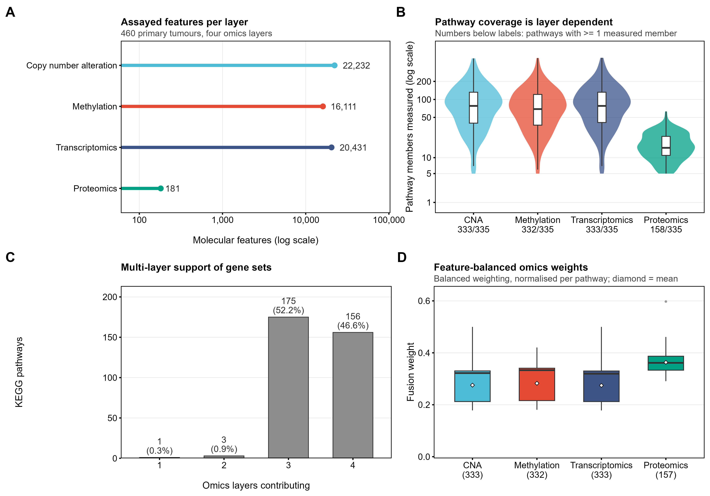
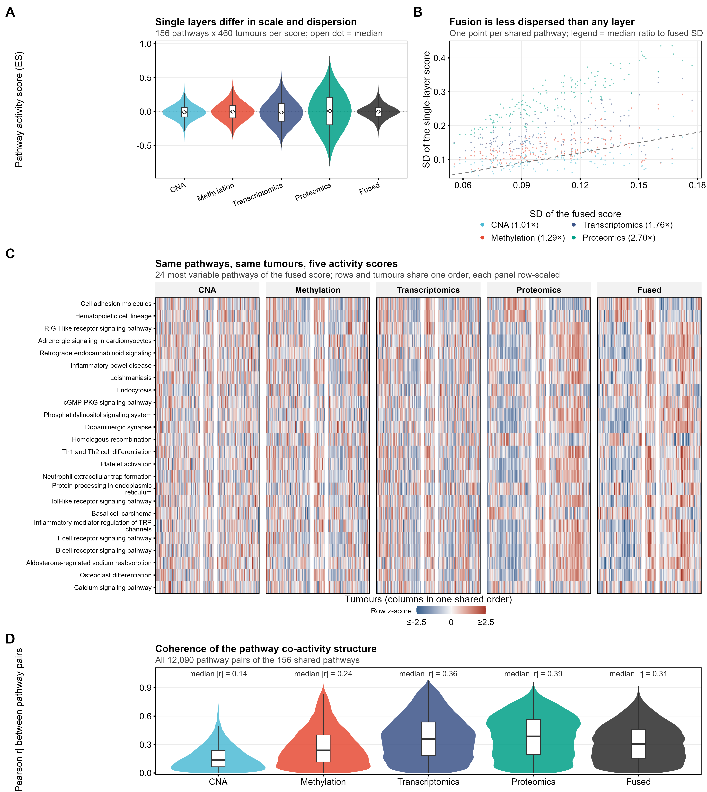
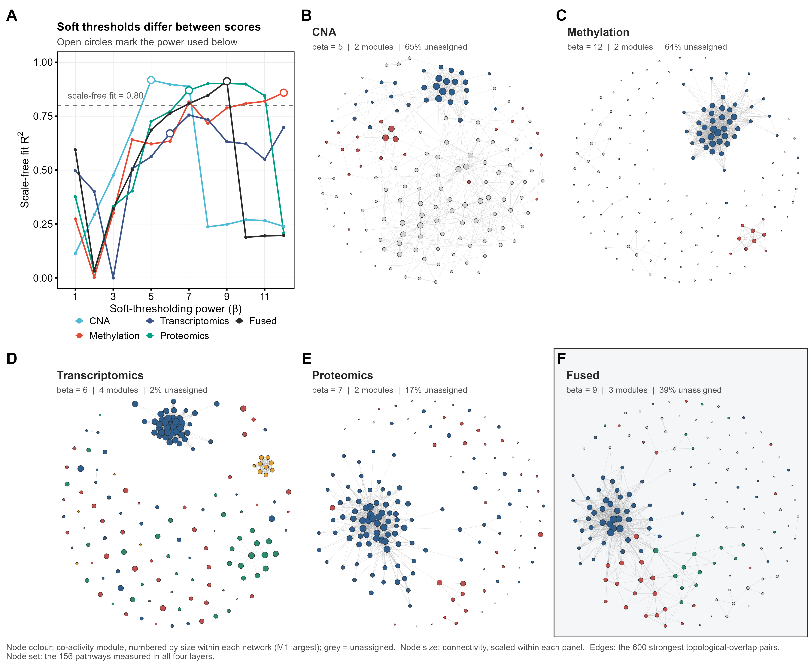
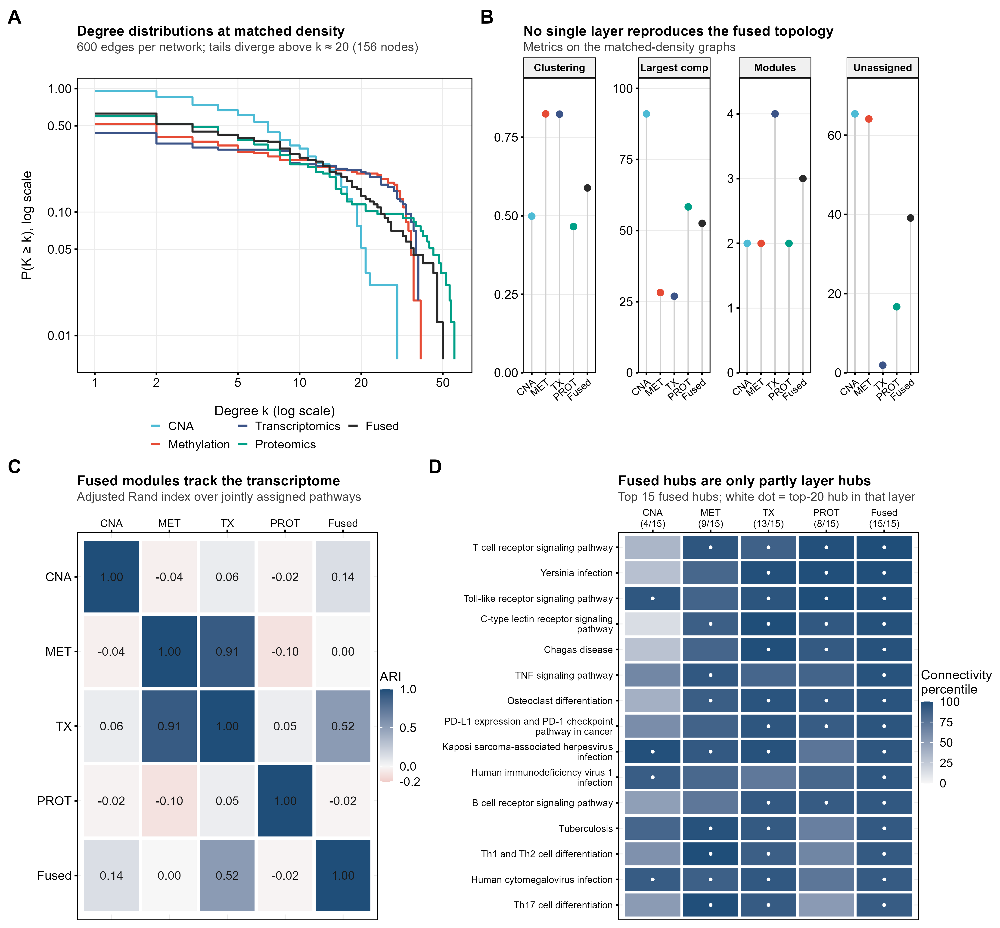
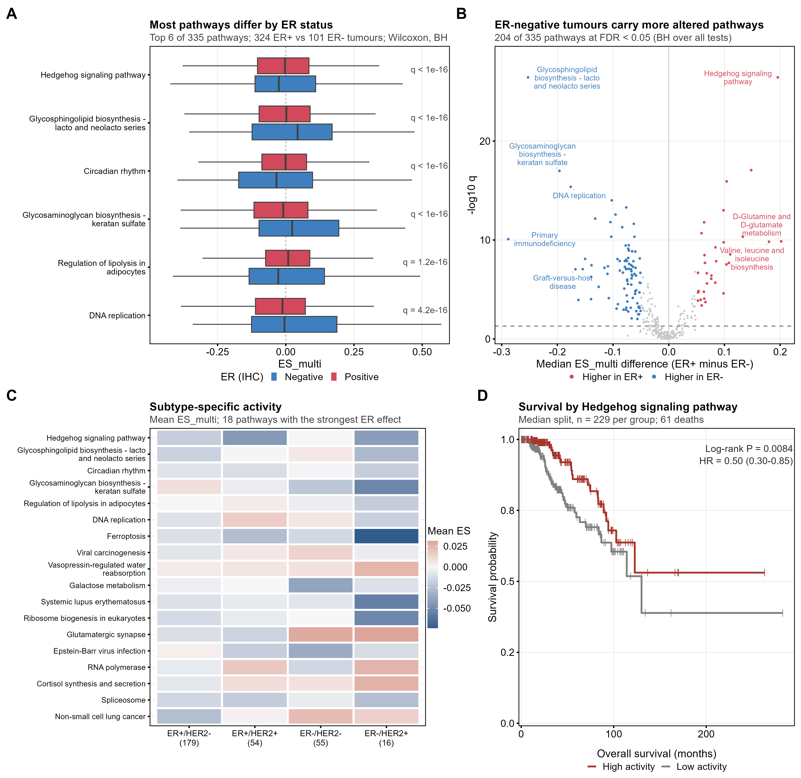
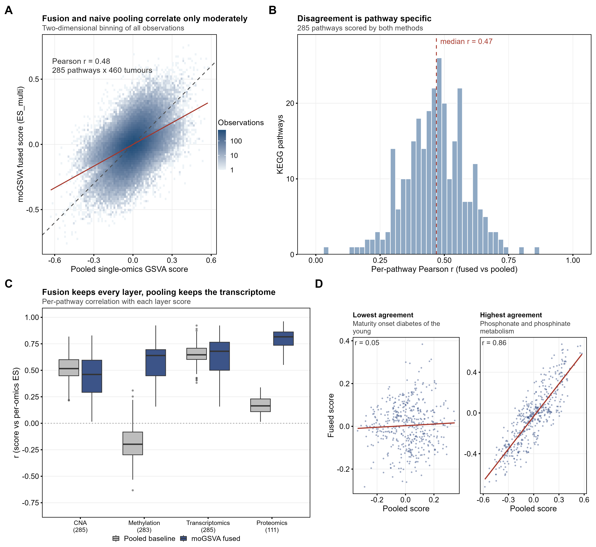

# 同一批肿瘤，四种组学：单组学 GSVA 与 moGSVA 的正面对撞

460 个乳腺癌、四个组学层、335 条 KEGG 通路。融合分数到底比"逐层算完再平均"强在哪？这篇文章把该泼的冷水泼完，再讲清楚它真正的价值。

> 面向：生物信息 / 计算生物学方向的研究生　｜　预计阅读 30 分钟
> 数据：TCGA-BRCA（PanCanAtlas 处理版）　｜　配套：上篇讲数学，本篇讲实证

---

## 目录

1. [先看数据：460 个肿瘤怎么变成四个矩阵](#1-先看数据460-个肿瘤怎么变成四个矩阵)
2. [疾病背景：乳腺癌根本不是一种病](#2-疾病背景乳腺癌根本不是一种病)
3. [实验设计：三条路线，必须站在同一起跑线](#3-实验设计三条路线必须站在同一起跑线)
4. [结果一：五个分数，长得很不一样](#4-结果一五个分数长得很不一样)
5. [结果二：排序几乎一模一样（先泼冷水）](#5-结果二排序几乎一模一样先泼冷水)
6. [结果三：网络拓扑确实不一样](#6-结果三网络拓扑确实不一样)
7. [结果四：临床与生存](#7-结果四临床与生存)
8. [生物学解读：谁在驱动，为什么](#8-生物学解读谁在驱动为什么)
9. [客观评价：四条优势，四条劣势](#9-客观评价四条优势四条劣势)
10. [给研究生的实践清单](#10-给研究生的实践清单)
11. [写在最后](#11-写在最后)

---

## 1. 先看数据：460 个肿瘤怎么变成四个矩阵

数据来自 TCGA 乳腺癌队列（BRCA），PanCanAtlas 处理后发布的多组学版本，全部是**原发灶**、同一批 460 个肿瘤、样本轴严格对齐。四层分别是：

| 层 | 特征数 | 原始量纲 | 预处理 | 覆盖通路数 |
|---|---:|---|---|---:|
| 拷贝数变异 CNA | 22,232 | 相对拷贝数（连续） | 基因水平 GISTIC 值 | 333 / 335 |
| DNA 甲基化 | 16,111 | β 值 [0, 1] | 探针→基因，取代表位点 | 332 / 335 |
| 转录组 mRNA | 20,431 | log2(RSEM+1) | 基因水平表达 | 333 / 335 |
| 蛋白组 | **181** | log2 比值 | 质谱定量 | 158 / 335 |

请盯住最后一列。蛋白层**只有 181 个蛋白**，只能覆盖 158 条通路——这是整篇文章里所有"不平衡"的源头。四层都覆盖的通路只有 **156 条**；三层覆盖的 175 条，只有一层的 1 条。



*图 1｜输入数据的整体样貌。**A** 四层的特征数（对数轴）；**B** 每层在每条通路里实际测到的成员数（小提琴图，轴为 log1p），横轴下方是"至少测到一个成员"的通路数；**C** 按支持层数统计的通路数——156 条四层齐全，175 条三层；**D** 特征数平衡后的融合权重分布，蛋白层因为成员最少，反而拿到最大的平均权重（0.36）。*

> **为什么先讲覆盖？** 因为后面所有的比较都必须回答一个问题：*你是拿 335 条通路比，还是拿 156 条共同通路比？* 拿全部 335 条比，蛋白层天然缺席一半，结论会被覆盖度而不是生物学支配。本文所有"同台竞技"的比较，都在 156 条（或 285 条，考虑到池化基线）共同通路上完成。

---

## 2. 疾病背景：乳腺癌根本不是一种病

如果只用一句话概括乳腺癌的分子病理，大概是：**它是一组由不同驱动事件、不同治疗反应、不同预后组成的疾病集合，只是碰巧长在同一个器官上。**

### 三个免疫组化指标决定了临床分型

**ER（雌激素受体）**阳性约占 70%，肿瘤依赖雌激素信号生长，内分泌治疗（他莫昔芬、芳香化酶抑制剂）有效；**PR（孕激素受体）**常与 ER 共表达；**HER2** 扩增见于约 15–20%，对应曲妥珠单抗等靶向治疗。三者组合出的"临床亚型"直接决定一线方案：

- **ER+/HER2−**：最常见，内分泌治疗为主，总体预后最好；
- **ER+/HER2+**：内分泌 + 抗 HER2；
- **ER−/HER2−**（俗称三阴性，TNBC）：侵袭性强、复发早、缺靶点，化疗为主；
- **ER−/HER2+**：抗 HER2 为主。

本队列里四组分别是 179 / 54 / 55 / 16 例，另有 156 例因 HER2 缺测或结果不确定（equivocal）无法归类。

### 为什么非要"多组学"

因为从基因组到表型，中间隔着好几道闸门，任何一道都能改写结论：

**拷贝数 → 表达**：扩增不一定带来高表达，还要看有没有甲基化沉默、有没有 miRNA 抑制。
**甲基化 → 沉默**：启动子高甲基化可以让一个关键抑癌基因彻底闭嘴，而 mRNA 层只看到"它很低"，看不到"为什么低"。
**mRNA → 蛋白**：转录本丰度和蛋白丰度的相关性在多数基因上只有 0.4 左右；真正执行功能、也是药物靶点的，是蛋白。

换句话说：**只看 mRNA，你会把"甲基化沉默"误读成"这个通路天生不活跃"；只看蛋白，你会漏掉驱动它的拷贝数事件。** 这正是多组学融合想解决的问题——不是把四个数平均一下，而是保留"哪一层在驱动"的信息。

---

## 3. 实验设计：三条路线，必须站在同一起跑线

我们比较三种做法：

| 路线 | 做法 | 直觉 |
|---|---|---|
| **Merge（合并）** | 每层单独跑 GSVA，再把有覆盖的层**等权平均** | "四个专家各打一票，取平均" |
| **Pooled（池化）** | 把四个矩阵上下摞成一个矩阵，**跑一次** GSVA | "把四个人关进一间屋，让他们吵出一个结论" |
| **moGSVA（融合）** | 层内打分 → 特征数平衡加权 → 一致性奖励 | "按专业程度加权投票，意见分歧时降低置信度" |

公平比较的前提是**节点集一致**：所有方法都在同一批通路上打分，否则"命中数多"可能只是"参与比较的通路多"。池化基线因为拼接后成员数变化，实际能打 285 条；为了对齐，我们在 285 条共同通路上做三方差值对比。

---

## 4. 结果一：五个分数，长得很不一样

先不谈融合，只看**同一批 156 条通路**在五个分数里的样子：



*图 2｜单层活性与融合活性的正面对照（156 条四层通路）。**A** 五种分数的活性分布；**B** 24 条高变通路 × 460 个肿瘤的 5 张并排热图，行列共享同一顺序，每格在各自面板内做行 z 化；**C** 每条通路在单层与融合中的离散度对比（图例括号内为相对融合 SD 的中位倍数）；**D** 全部 12,090 个通路对的 |r| 分布。*

三个立刻能读出来的事实：

**① 四层的"嗓门"差很多。** 蛋白层的通路分数标准差中位数是 0.27，CNA 只有 0.10——差了 2.7 倍。这意味着任何"等权平均"实际上都是"蛋白主导平均"。

**② 融合分数比任何单层都"安静"。** 融合的 SD 中位数是 0.10，只有蛋白层的 1/2.7、转录组的 1/1.8。原因在上一篇讲过：一致性奖励是乘性衰减，|ES<sub>multi</sub>| ≤ |ES<sub>raw</sub>|。

**③ 通路之间的"共变强度"也是分层的。** 同一层内两条通路的 |r| 中位数：CNA 0.14、甲基化 0.24、转录组 0.36、蛋白 0.39，融合 0.31。CNA 最"各自为政"（局灶扩增本来就只影响一小段染色体），蛋白与转录组的通路活动最"成团"。

---

## 5. 结果二：排序几乎一模一样（先泼冷水）

如果只允许看一个数字，很多人会想看"融合分数和简单平均差多少"。答案是：

> 逐通路的 Spearman 相关系数，中位数 **0.994**。

也就是说，**把四个分数按等权平均，和用 moGSVA 融合，得到的样本排序几乎完全一样**。进一步拆解能看清原因（这一拆分很值得记住）：

| 对比 | 逐通路 Spearman ρ（中位） | 说明 |
|---|---:|---|
| 融合分数 vs 等权平均 | 0.994 | 整体几乎等价 |
| 加权平均（λ=0）vs 等权平均 | 0.9987 | 单看"权重"这一步，几乎不改排序 |
| 融合分数 vs 加权平均（λ=0） | 0.9976 | 单看"一致性奖励"这一步，也几乎不改排序 |

原因上一篇已经埋好了：**一致性奖励是一个逐样本的正标量** (1 + <i>λa</i><sub><i>j</i></sub>) / (1 + <i>λ</i>)，它改变幅度、不改变次序。而特征数平衡权重在多数通路上也接近等权（三层通路各拿 1/3 左右）。

> **所以，任何"融合显著提升了样本分型/聚类效果"的说法，在这份数据上都是站不住的。** 融合带来的不是"更好的排序"，而是"同样的排序 + 一个可信度标签 + 一份归因账本"。这一点必须在论文里讲清楚，否则审稿人一句"你和简单平均的相关系数是多少"就能把故事掀翻。

---

## 6. 结果三：网络拓扑确实不一样

既然排序一样，那还有没有结构性差异？有，而且不小——把每条通路当节点、把"跨肿瘤共变"当边，做 WGCNA 网络，五张图的形状很不一样。



*图 3｜五张通路共表达网络（同一批 156 条通路，每张图都取最强的 600 条 TOM 边，保证密度一致）。节点颜色是模块（按模块大小编号，灰色=未归属），大小是连通度。**A** 软阈值诊断：各分数需要的最优 β 差异很大（5/12/6/7/9）。**B–F** 依次为 CNA、甲基化、转录组、蛋白与融合网络。*

肉眼可见的三件事：

**CNA 是一张"稀薄的大网"**——65% 的节点没有归属任何模块，但它有最大的连通分量（91% 的节点连在一起）。这符合拷贝数变异的生物学：局灶扩增/缺失是稀疏事件，但一旦发生，往往牵动一大片相邻基因。

**甲基化和转录组碎成许多"紧密小团"**——聚类系数高达 0.82，但最大连通分量只占 27–28%，剩下的是一个个互相独立的小岛。这是"模块化"的典型形态：少数基因被协同调控，其余互不相干。

**融合网络是"紧凑核心 + 连通边缘"**——聚类系数 0.59（中等），最大连通分量 53%（过半），未归属 39%。它既没有 CNA 那么弥散，也没有转录组那么碎。



*图 4｜网络拓扑的量化比较。**A** 匹配密度后的度分布（双对数），k>20 之后尾部明显分化；**B** 四项拓扑指标；**C** 模块划分的一致性（ARI，只在双方都归属的节点上算）；**D** 融合网络前 15 个 hub 在各自网络里的连通度百分位，白点表示该层的 top-20 hub。*

几个值得抄进论文的数字：

| 指标 | CNA | 甲基化 | 转录组 | 蛋白 | 融合 |
|---|---:|---:|---:|---:|---:|
| 软阈值 β | 5 | 12 | 6 | 7 | 9 |
| 聚类系数 | 0.50 | 0.82 | 0.82 | 0.47 | 0.59 |
| 最大连通分量占比 | 91% | 28% | 27% | 58% | 53% |
| 检出模块数 | 2 | 2 | 4 | 2 | 3 |
| 未归属节点 | 65% | 64% | 2% | 17% | 39% |

模块层面还有一个很有意思的发现：**甲基化与转录组的模块划分几乎重合（ARI = 0.91）**，融合模块最接近转录组（0.52），而 CNA 与蛋白的模块和其他分区基本无关（|ARI| ≤ 0.14）。这在生物学上讲得通——启动子甲基化本来就是表达程序的主要"开关"之一，两者的模块自然会长得很像；而拷贝数事件是局部的、蛋白层又只有 181 个特征，模块结构自然另成一套。

---

## 7. 结果四：临床与生存



*图 5｜融合分数的临床关联。**A** ER 阳性 vs 阴性差异最大的六条通路；**B** 全部 335 条通路的 ER 对比火山图（204 条 FDR<0.05，其中 143 条在 ER 阴性中更高）；**C** 四个 IHC 亚型的平均活性谱；**D** ER 差异最强的 Hedgehog 通路的 Kaplan–Meier 曲线。*

把三条路线的下游表现摆在一起（285 条共同通路，ER：324 阳性 vs 101 阴性）：

| 指标 | moGSVA | Merge（等权） | Pooled（池化） |
|---|---:|---:|---:|
| ER 关联通路数（FDR<0.05） | 173 | **185** | 135 |
| ER 最小 q 值 | 3.1e−27 | 2.8e−27 | 6.4e−10 |
| OS 关联通路数（FDR<0.05） | 2 | 1 | 1 |

这张表里有两个方向完全相反的信息，必须一起说：

**对简单平均，融合没有优势**：185 vs 173，等权平均甚至多找出 12 条。原因不是信息丢失，而是**全局衰减**——一致性奖励把所有分数整体缩小（SD 比 0.94），Wilcoxon 检验量跟着变小。两法的 ER 效应量相关高达 r = 0.986，命中的通路 202/204 重合，差的只是"贴不贴 FDR 线"。

**对拼接池化，融合是碾压性的**：173 vs 135（多 28%），最小 q 差了 **17 个数量级**。池化为什么这么差？上一篇的"坑一"在这里现形了：拼接后 KDE 被数值范围最大的层主导，池化分数与甲基化层的相关性是 **−0.20**（方向都反了），与蛋白层只有 0.16——它基本只是转录组的一份粗糙替身。



*图 6｜与拼接池化基线的消融对比。**A/B** 两种分数整体只中度相关（r = 0.48），逐通路中位 0.47；**C** 关键证据：池化分数能复现转录组（0.65），却与甲基化反相关（−0.20）、对蛋白几乎无信息（0.16）；融合分数对四层都保持在 0.46–0.82。*

---

## 8. 生物学解读：谁在驱动，为什么

### 8.1 融合网络的 hub 是一个免疫模块，而且长在 ER 阴性肿瘤里

融合网络连通度最高的十个通路是：**T 细胞受体信号、Toll 样受体信号、TNF 信号、C 型凝集素受体信号、PD-L1/PD-1 检查点、破骨细胞分化，以及 Yersinia 感染、恰加斯病、卡波西肉瘤、HIV-1 感染**四个"感染类"基因集。

名字看着杂乱，其实是同一件事：**KEGG 的"感染病"通路大量复用了宿主免疫反应的基因**（NF-κB、JAK-STAT、抗原呈递、细胞因子）。把它们放在一起，就是一张典型的"炎症/免疫浸润"网络。

更关键的是方向：这十个 hub 在 **ER 阴性肿瘤中全部显著更高**（Wilcoxon P 从 1.6e−9 到 6.1e−11，中位活性差 0.06–0.08）。这与乳腺癌的临床共识一致——三阴性/ER 阴性肿瘤突变负荷高、肿瘤浸润淋巴细胞（TILs）多、PD-L1 表达高，也正是免疫检查点抑制剂在这类患者中更有效的原因。

> **为什么这个信号在融合网络里最稳？** 因为它是**跨层一致**的：CNA 层面看得见 9p24（JAK2/PD-L1）扩增，甲基化层面看得见免疫基因启动子低甲基化，转录组和蛋白层面看得见 IFN-γ 通路激活。四层方向一致，<i>a</i><sub><i>j</i></sub> 高，融合时几乎不打折；而噪声通路往往只有一层"喊得响"，其余层不跟随，就会被一致性项压下去。**这正是方法设计的初衷，也是它唯一能站得住的"生物学优势"叙事。**

### 8.2 甲基化与转录组模块高度重合（ARI 0.91）说明了什么

说明在这批肿瘤里，**表达程序的差异有很大一部分是"被甲基化写死"的**：启动子甲基化状态和基因表达模块几乎是同一张图的两种画法。这也解释了为什么 CNA 的模块（ARI 与谁都不沾边）在融合里权重不小、但生物学解释力有限——拷贝数事件更多是"点火"，真正决定表型的是后续的转录与翻译层。

### 8.3 蛋白层主导方差：既是优点也是隐患

在 156 条四层通路上，融合分数的方差有 **72.8%** 来自蛋白层（等权平均是 45.4%）。原因有两层：蛋白成员数最少→平衡权重最大（0.36 vs 0.27）；蛋白本身的离散度也最大（SD 0.27 vs 0.10–0.17）。

从生物学上讲，这未必是坏事：蛋白才是功能分子、也是药物靶点，让蛋白层"说话大声一点"有道理。但从统计上讲，蛋白层只有 **181 个特征**，是四层里最"薄"的一层，把七成方差压在它身上，等于把结论的稳健性押在一个小 panel 上。这一点在讨论里必须主动交代。

### 8.4 Hedgehog 与 ER 轴

ER 对比最强的通路是 Hedgehog 信号（q = 3e−27，ER 阳性更高）。按中位数二分后，高活性组预后更好（HR = 0.50，95% CI 0.30–0.85，log-rank P = 0.0084，61 例死亡）。这个方向与"ER 阳性预后更好"是一致的——它更像是 ER 轴的一个下游读数，而不是一个独立的预后因子。任何更强的解读都需要多变量模型或外部验证。

---

## 9. 客观评价：四条优势，四条劣势

### 优势

**① 归因是额外维度，不是副产品。** 每条通路、每个肿瘤都能给出四层的贡献份额。主导层在肿瘤之间并不稳定：每条通路中位出现 **3 种**不同的主导层，仅 1/335 条通路"所有肿瘤主导层一致"，42.3% 的观测由非众数层主导。任何固定 1/K 的平均都无法表达这件事。

**② 冲突被量化，而不是被平均掉。** 一致度 <i>a</i> 可以直接当"置信度"字段。数据上，<i>a</i> = −1/3 的样本（多数派压倒少数派）在等权平均里仍然报出比融合高 **36%** 的幅度；<i>a</i> = −1（完全对立）时高 **67%**。把"四层互相矛盾"渲染成"中等活性"，是简单平均最危险的地方。

**③ 相对拼接池化是实质提升。** ER 命中 173 vs 135，最小 q 差 17 个数量级；逐层还原度 0.46–0.82 vs 甲基化 −0.20、蛋白 0.16。如果论文的对照是"拼接矩阵直接跑 GSVA"，这是压倒性的证据。

**④ 全流程可审计。** 权重规则有解析形式（1 / log<sub>2</sub>(2 + |<i>S</i>|)）、融合恒等式可验证、贡献可加和、一致度可重算、p 值落在 1/(<i>B</i> + 1) 网格上。这些都是可以写进补充材料的硬检查（我们的审计脚本里最大偏差 ≤ 3e−16）。

### 劣势

**① 对"逐层合并"没有检出优势，反而略低。** 185 vs 173（285 条共同通路）。全局衰减会系统性地压低检验统计量，做单变量关联时吃亏。要主张"更灵敏"，必须先把 λ 调到 0 再比，或者改用多变量/生存模型。

**② 更容易被"薄"的层绑架。** 特征数平衡按成员数补偿，蛋白层因此拿到最大权重，叠加其自身离散度最大，最终融合分数的方差 72.8% 来自蛋白。这不是"更均衡"，而是"更偏向小 panel"。

**③ 不改变排序，所以不能宣称"重构了活性谱"。** 与等权平均的逐通路 ρ = 0.994。它的价值在幅度校准与可信度标记，不在重新排序。任何"融合显著改善分型"的表述都会被这一条打回。

**④ 显著性检验偏保守，且对覆盖度敏感。** max<sub><i>j</i></sub> |ES| 统计量的零分布偏右，p 值整体偏保守；200 条通路、1000 次置换下最小 q = 0.057，仍无通路通过 FDR<0.05。另外 <i>a</i> 的取值被层数 <i>K</i> 量化（四层 6 对、三层 3 对），**不同覆盖度的通路之间不能直接比较一致度**。

---

## 10. 给研究生的实践清单

如果你正准备在自己的数据上跑 moGSVA，这几条能省下不少返工：

```text
1. 先算覆盖度，再决定分析集
   coverage.csv → 统计每条通路有几层覆盖
   · 四层齐全的子集（本例 156 条）用于"同台比较"
   · 全量 335 条用于"探索"，但别拿覆盖率不同的通路互相比 a

2. 明确你的对照组是谁
   · 对手是"拼接池化" → 可以正面主张优势
   · 对手是"逐层合并" → 只能主张可解释性，别主张灵敏度

3. 想做下游关联，先把 λ 说清楚
   λ=0.25（默认）会整体压低幅度，单变量检验吃亏
   建议同时报 λ=0 与 λ=0.25 两套结果，让读者看到一致性项的代价

4. 检查权重是否被某一层绑架
   contributions.csv 里按 omics 汇总 |share|
   若某一层方差贡献 > 60%，补一个 balance_feature_size=FALSE 的敏感性分析

5. 置换检验别只看 p
   significance.csv 的 p 值若是 1/(B+1) 的整数倍，说明有效置换数是 B
   想把 q 压到 0.05 以下，先确认 B 够不够大

6. 网络分析固定边数再比较
   不同 β 下 connectivity 不可比
   统一取"最强 N 条 TOM 边"，再比较聚类系数/连通分量/模块
```

---

## 11. 写在最后

回到最初那个问题：**moGSVA 到底比"逐层算完再平均"强在哪？**

用一句话回答：**它不改变结论的排序，但改变了结论的可解释程度和可信度表达方式。** 同样的通路活性谱，你可以多说三件事——这条信号是哪一层给的、四层是否同意、在哪些肿瘤里不可信。而在"拼接池化"这个更粗糙的对手面前，它还额外赢回了被量纲淹没的两个层。

至于它没做到的事：没能提升单变量检出、没能真正"平衡"掉蛋白层的强势、也没能在 200 条通路的置换检验里给出一个 FDR<0.05 的结果。这些不是实现 bug，而是方法设计本身的取舍——写论文时把它们讲清楚，比硬拗一个"全面优于"的故事要安全得多。

*— 下篇完 —　｜　数据与脚本：`mogsva_figures/`（`run_all.R` 一键复现全部图）*
