# 把一锅乱炖拆成四盘菜：DNMF 如何把混合菌群的转录组"分家"

> 这是一篇关于算法的文章，但我不想把它写成论文。你只需要知道矩阵乘法是什么，剩下的交给比喻。

## 一、先从一个让人头大的实验说起

假设你养了一锅汤，里面住着四位房客：Y1、K1、B1、H1。它们是被精心挑出来的除草剂降解菌，凑在一起能干掉八种除草剂，效率比任何一位单干都高。

你很想知道：**这四位到底各自在干什么？**

于是你把整锅汤拿去测了转录组。机器很争气，吐给你一个漂亮的矩阵：5236 行基因 × 24 个样本。每一行是一个基因的读数，每一列是一个样本。

然后问题来了——**这 5236 行里，哪一行是 Y1 在表达，哪一行是 K1 在表达？**

答案是：不知道。因为转录组测的是"这锅汤里所有 RNA 的总和"。你手里只有一份混合账单，上面写着"本月餐饮总支出 8000 元"，却没写谁吃了牛排、谁吃了素面。

用行话说，这叫 **deconvolution（解卷积）**；用厨房话说，这叫**分账**。

本文要讲的 DNMF（Discriminative Non-negative Matrix Factorization，判别式非负矩阵分解），就是我们用来分账的那把刀。

---

## 二、我们手里的牌

分账之前，先看看作弊材料。虽然是"盲解"，但我们并不是一无所知——这很关键。

**第一张牌：每个菌株的基因组。**

我们测过这四位的基因组，所以知道 `Y1_atzA` 这个基因只可能来自 Y1，`H1_rpoA` 只可能来自 H1。基因 ID 自带门牌号，这是天然的**先验归属**。

**第二张牌：跨菌株的同源家族。**

有些基因不是独门独户的。比如阿特拉津降解的 `atzA`，四个菌株各带一份拷贝，序列还挺像。测序时，同一家族的 reads 会因为相似性而**互相串门**——本来属于 Y1_atzA 的 reads，可能有 25% 被错分到 K1_atzA 头上。这类基因是"分账难点"，得单独处理。

**第三张牌：菌株数 K 是已知的。**

我们明知道锅里住着 4 位，不需要猜。这在数学上是巨大的便利——很多分解算法最头疼的就是"到底该拆成几份"。

所以这个问题不是纯粹的盲源分离，而是**带结构先验的半监督分解**。DNMF 的巧妙之处，全在"如何把这些先验塞进矩阵分解"里。

---

## 三、目标：一个矩阵变四个

形式化一下。设总矩阵为 <b>X</b>，有 <i>m</i> 个基因、<i>n</i> 个样本。我们想把它拆成 <i>K</i> 个菌株矩阵之和：

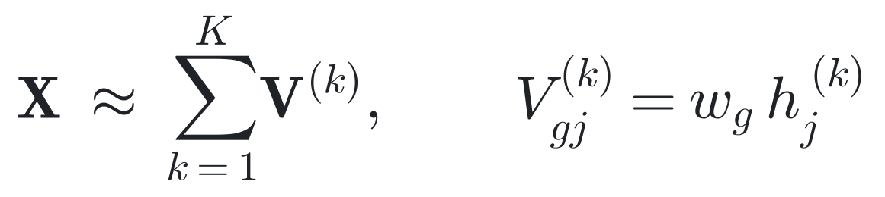

其中 <i>V</i><sup>(<i>k</i>)</sup> 是第 <i>k</i> 个菌株自己的表达矩阵（同样是基因 × 样本），而它的每个元素被写成"基因权重 × 菌株活性"的乘积：<i>w<sub>g</sub></i> 是这个基因的表达强度，<i>h</i><sup>(<i>k</i>)</sup><sub><i>j</i></sub> 是这个菌株在第 <i>j</i> 个样本里的活跃程度。

用人话说：**一个基因写多少，取决于它本身多活跃（<i>w</i>）和它主人当时多活跃（<i>h</i>）**。

这个假设很强，但很合理——毕竟同一个菌株的所有基因，确实会随菌株整体状态一起涨落。

---

## 四、从 NMF 开始：两个非负矩阵的乘积

最朴素的做法是非负矩阵分解（NMF）。给定矩阵 <b>A</b>，找两个非负矩阵 <b>W</b> 和 <b>H</b>，使得它们的乘积尽量接近 <b>A</b>：

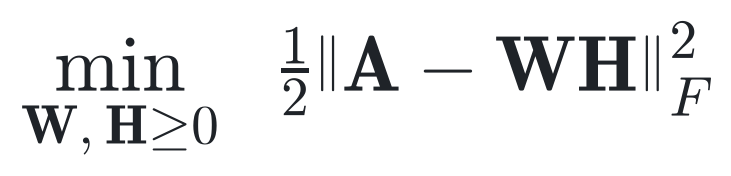

**为什么必须非负？** 因为表达量不能是负的。你可以有 0 条 reads，但不能有 −5 条。而普通的 PCA/SVD 会毫不客气地吐出负数——那些负数在数学上完全合法，在生物学上纯属胡扯。"负表达"没法解释，也没法画在热图上。

非负约束还有一个隐藏福利：它天然产生**稀疏、可加**的表示。每个观测被写成若干"部件"的和，就像调色一样，这比 SVD 那种"正负相消"的分解可解释得多。

经典解法是 Lee & Seung 的乘性更新（multiplicative update），交替刷新两个矩阵，每步都保证非负：

<b>H</b> ← <b>H</b> ⊙ (<b>W</b><sup>T</sup><b>A</b>) / (<b>W</b><sup>T</sup><b>W</b><b>H</b>)，<b>W</b> ← <b>W</b> ⊙ (<b>A</b><b>H</b><sup>T</sup>) / (<b>W</b><b>H</b><b>H</b><sup>T</sup>)

⊙ 是逐元素乘法。这套更新单调不增目标函数，简单、稳、不需要调步长——工程上极其友好。

但纯 NMF 有个致命问题：**它给出的因子是无政府状态的**。因子 1 到因子 4 只是四个"统计模式"，没有任何理由对应到具体的菌株。你拆出来四套矩阵，却不知道哪套是 Y1 的。

---

## 五、DNMF 的那个 "D"：让同类抱团，让异类分开

DNMF 的全名是 **Discriminative** NMF，判别式非负矩阵分解。它的思路来自线性判别分析（LDA）：**同一类的样本在表示空间里应该靠近，不同类的应该远离**。

在我们的场景里，"类"就是菌株。基因 <i>g</i> 属于哪个菌株，第三张牌已经告诉我们了。于是我们可以在 NMF 的目标函数上，加两项"拉"和"推"：

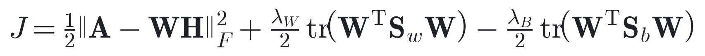

前半截还是老熟人：重构误差，要求 <b>WH</b> 别离 <b>A</b> 太远。

后面两项是新增的判别约束：

- <b>S</b><sub><i>w</i></sub> 是**类内散度**，tr(<b>W</b><sup>T</sup><b>S</b><sub><i>w</i></sub><b>W</b>) 越小，同菌株的基因在表示空间里越挤成一团。这一项前面是**加号**（惩罚），逼它们抱团。
- <b>S</b><sub><i>b</i></sub> 是**类间散度**，这一项前面是**减号**（奖励），鼓励不同菌株的基因被推得越远越好。

<i>λ</i><sub><i>W</i></sub> 和 <i>λ</i><sub><i>B</i></sub> 是两个旋钮，控制"抱多紧"和"推多远"。代码里默认都是 0.1——不算激进，属于"轻声提醒"而不是"暴力驱赶"。

对应的更新规则，就是把判别梯度按正负部分拆开，保持乘性形式：

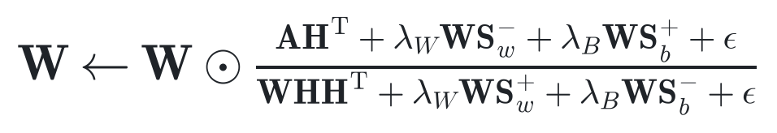

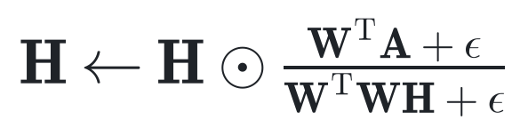

<b>S</b><sup>+</sup> 和 <b>S</b><sup>−</sup> 是散度矩阵的正部与负部。把一项拆成正负两块塞进乘性更新的分子分母，是 NMF 家族的经典操作——它保证了**每步更新后元素仍然非负**，不需要额外做投影。

到这里，因子已经"有判别力"了：同一菌株的基因会更倾向于挂在同一个因子上。

**但因子仍然只是一个数字编号。** 还得把它翻译成菌株名字。

---

## 六、因子 → 菌株：一场投票

这一步在代码里叫 `AssignFactors`，逻辑朴素得有点可爱。

对每个菌株，把它**专属的标记基因**（marker gene，即没有同源拷贝、独门独户的那些）挑出来，看这些基因在各个因子上的平均权重。哪个因子对它们最热情，这个因子就是它家。

得到一个"菌株 × 因子"的打分表后，剩下的就是**一对一指派**问题——每个菌株配一个因子，不许重复。菌株数不多时（代码里的阈值是 <i>k</i> ≤ 8）直接穷举全排列——4 个菌株就是 4! = 24 种，秒出；超过 8 个才退而求其次改用贪心。

这个设计有个细节值得夸：如果一个菌株**没有任何可用的标记基因**（比如基因组之间同源性太高，人人都长得像），代码会退化为用它全部基因打分，并打一条警告。不静默、不硬撑，这种处理方式很讨喜。

---

## 七、真正的主力：结构掩码 + 交替非负最小二乘

指派完成之后，按理说直接拿 <b>W</b> 的第 <i>k</i> 列和 <b>H</b> 的第 <i>k</i> 行相乘就完事了。但作者没这么干，而是加了一层"掩码精化"（`RefineMasked`）。

为什么？因为 NMF 的解**不唯一**。同一份 <b>A</b>，可以有很多组 (<b>W</b>, <b>H</b>) 给出差不多的重构误差。不同的初始化、不同的随机种子，可能拆出数值不同、甚至归属不同的结果。对于一个要写进论文的分析，这不能忍。

解决办法是加一条**硬约束**：**一个基因只允许挂到它自己菌株的因子上**。

这条约束一旦加上，问题就从一个"欠定的矩阵分解"变成了一堆**独立的最小二乘**——每个菌株各算各的，互不干扰，解唯一、可重复。

更新公式是交替的闭式解（alternating non-negative least squares）。先固定活性谱，解基因权重：

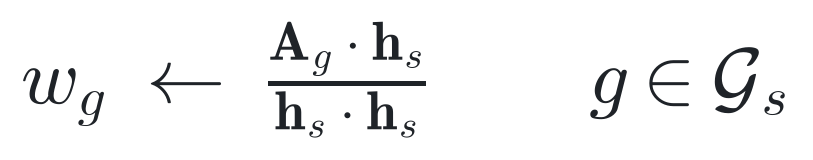

再固定权重，解活性谱：

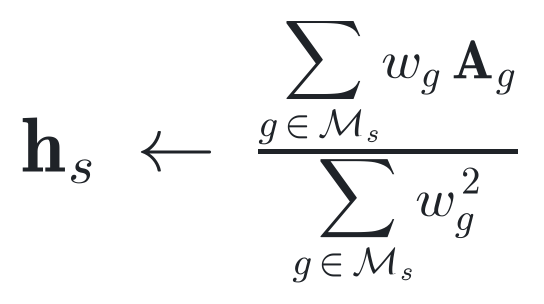

注意第二式里的 <i>M<sub>s</sub></i> ——它是**只用标记基因**的子集，而不是该菌株的全部基因。

这个细节是整段代码里最老练的一笔。原因是：同源基因行里混着别的菌株的信号，如果让它们参与活性谱的估计，这点偏差会通过 <i>h<sub>s</sub></i> **扩散到整株所有基因**上去。用干净的标记基因估活性，再用这个活性去投影全部基因，等于"用干净的水尺量水位，再拿它去浇整片地"。

而第一式里 <i>g</i> 遍历的是该菌株的全部基因 <i>G<sub>s</sub></i>，没有缩水——每个基因都老老实实被投影了一次。

---

## 八、同源基因的分账：一个漂亮的闭式解

还剩最后一块硬骨头：同源家族。

前面说过，测序时同一家族的 reads 会互相串门。设某家族有 <i>m</i> 个成员（每个菌株一份），真实表达量是 <i>x</i><sub>1</sub>…<i>x<sub>m</sub></i>，观测到的是 <i>y</i><sub>1</sub>…<i>y<sub>m</sub></i>。如果交叉分配率是 <i>r</i>，一个对称的混合模型可以写成：

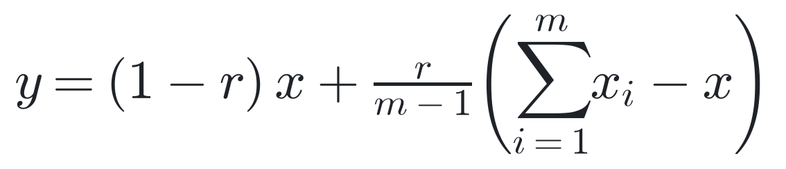

意思是：我观测到的 <i>y</i>，有 (1−<i>r</i>) 是我自己的，剩下 <i>r</i> 是从兄弟们那里平摊过来的。

这个式子可以**直接反解**：

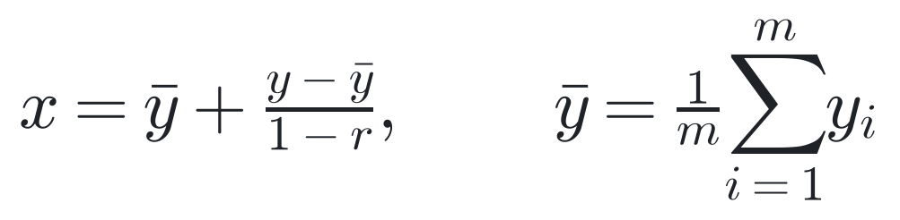

我第一次看到这个式子的时候愣了一下——它太干净了，以至于不像能 work 的样子。但它确实成立，而且有两个非常漂亮的性质：

1. **不依赖活性谱的形状**。如果用"按菌株活性做非负最小二乘"来回推，遇到活性谱高度共线（样本条件少、菌株齐涨齐落）时会崩。这个闭式解不需要活性谱，稳得多。
2. **天然守恒**：Σ<i>x</i> = Σ<i>y</i>。家族层面的总质量严格不变，既不凭空造信号，也不跨菌株重复计数。

代码里 <i>r</i> 默认 0.25（`CrossMapRate`），并且做了个边界检查：如果用户手滑传了 <i>r</i> ≥ 0.95，会自动回落到 0.25 并继续跑。这种"不许你把程序搞崩"的防御性写法，在科研代码里属于稀缺品质。

---

## 九、收尾：对齐与归一化

拆完之后还有两件小事，但都很关键。

**第一件：行对齐。** 输出的每个菌株矩阵，行数都是 **5236**——和总矩阵一模一样，只是不属于自己的基因行填 0。

代价是矩阵变"胖"了（4 个 5236 × 24，而不是 4 个 1317 × 24）。收益是**所有矩阵共享同一套基因坐标**，热图、表达趋势图、PCA 都能直接按行对齐，不用来回查表。需要"只看自己的基因"时，按基因组基因表做一次子集就行。

这个设计选择很务实：**存储换便利**。在一个动辄要做十几种可视化的项目里，这个交换划算得离谱。

**第二件：列归一化。** 因子模型有个自由度：把所有 <i>V</i><sup>(<i>k</i>)</sup> 一起放大两倍、把 <i>w</i> 缩小两倍，重构结果不变。于是四个矩阵加起来可能是群落总量的 4 倍、1 倍、或者 0.3 倍——**全看初始化时的随机数**。

这在生物学上很尴尬：你没法跟审稿人说"我的菌株表达量是群落总量的四倍"。

解决办法是按样本列做一次校正，让四个矩阵之和正好等于群落总量：

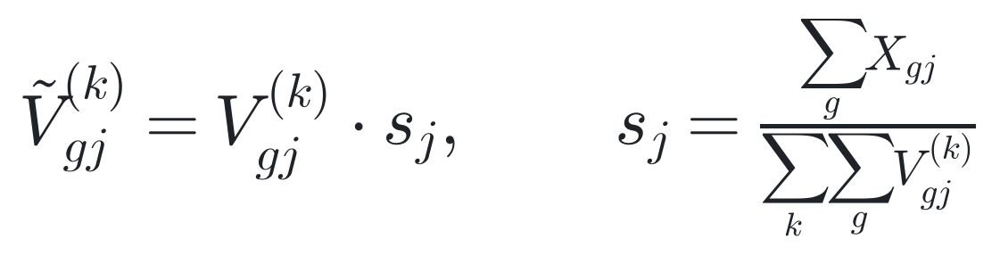

这一项在代码里是 `RescaleToTotal` 开关。**早期版本默认关闭**——不打开的话拿到的就是原始尺度（我们这个数据集上跑出来恰好是 3.87 倍，看上去像"每株的表达量都是群落总量的 3.87 倍"，这种结果没法往论文里写）。现在这个开关默认已开启，逐列比值精确变成 1.000，逐基因的散点也乖乖回到 1:1 线上。

> 小提醒：这个缩放是**列级、样本特异**的，它不改变同一列里四个菌株的相对比例，所以下游的组成分析、GSVA 打分都不受影响。但丰度系数的绝对值会整体缩小，跨样本比较时要留个心眼。

---

## 十、业务代码长什么样

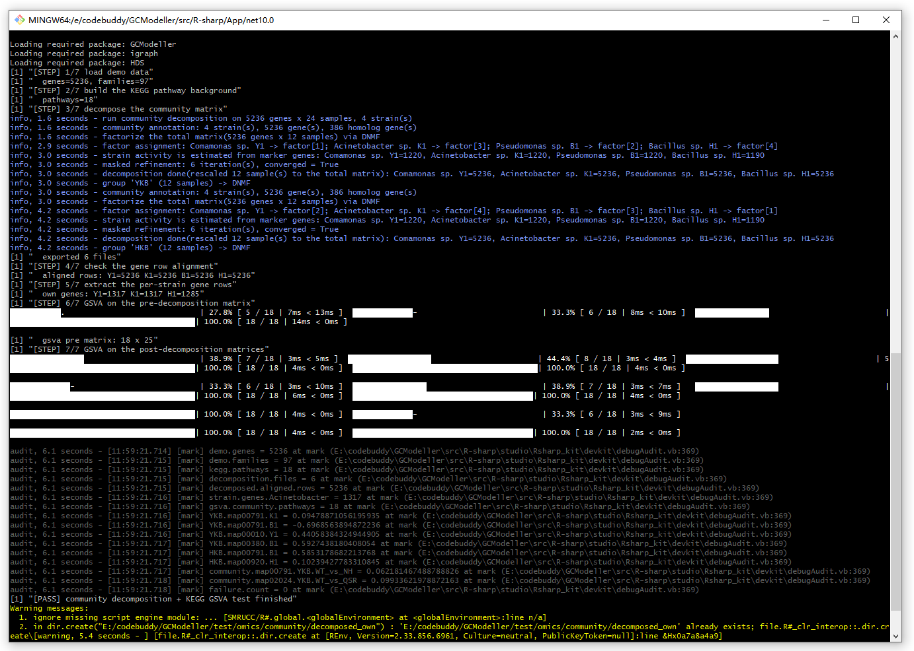

理论讲完，看看实际怎么用。VB.NET 那边的入口非常朴素：

```vb
' 四个菌株矩阵 + 丰度 + 诊断信息
Dim dec As CommunityDecomposition = Decomposition.Decompose(
    total,        ' 5236 基因 x 24 样本的总矩阵
    genomes,      ' 菌株 ID -> 基因 ID 列表
    families,     ' UnionFind 描述的跨菌株同源关系
    opt)          ' DecompositionOptions：方法、迭代数、lambda、是否归一化……

' 拿单个菌株的矩阵
Dim y1 As Matrix = dec.strains("Comamonas sp. Y1")
```

R# 脚本那边的业务流，去掉测试断言后其实只有五行：

```r
# 1. 读数据
let total    = geneExpression::load.expr(here("syncom/total.csv"));
let genomes  = read.csv(here("syncom/genomes.csv"));
let families = read.csv(here("syncom/families.csv"));

# 2. 分解（按菌群分组，固定随机种子保证可复现）
let dec = geneExpression::decompose_community(
    total, genomes, families,
    groups = list(YKB = c(...), HKB = c(...)),
    seed   = 42);

# 3. 导出：4 个菌株矩阵 + abundance + summary
let files = geneExpression::write.decomposition(dec, here("decomposed"));

# 4. 取某个菌株自己的基因行
let y1 = read.csv(here("decomposed/Comamonas sp. Y1.csv"));
let y1_own = geneExpression::filter(y1, geneId = geneExpression::strain_genes(genomes, "Comamonas sp. Y1"));

# 5. 打分：群落层与菌株层各做一次 GSVA
let gsva_pre  = GSVA::gsva(geneExpression::log_cpm(total),  bg, kcdf = "Gaussian");
let gsva_post = GSVA::gsva(geneExpression::log_cpm(y1_own), bg, kcdf = "Gaussian");
```

注意第 2 步的 `groups`。这里的关键是**按菌群分组分解**，而不是把 24 个样本一锅端。

为什么？因为 YKB 里根本没有 H1，HKB 里也没有 Y1。如果混在一起分解，缺失成员会被强行分配到一个"空因子"上，那个因子的活性谱就是纯噪声——后续所有基于它的结论都是垃圾。分组分解等于提前告诉算法："这两拨人不住一起"。

这个细节不写进方法学部分的话，审稿人很可能会问。

---

## 十一、客观评价：这把刀好在哪，钝在哪

用了这么久，说几句实在话。

### 优势

**1. 它不需要参考图谱。**
对比那些依赖"纯培养参考表达谱"的解卷积方法（比如很多微生物组工具），DNMF 只需要基因组注释和同源关系，不需要事先测一遍每个菌株单独培养的转录组。这对难培养微生物是决定性的优势——你没法给一个还没纯化出来的菌做参考谱。

**2. 它给出的不是比例，是矩阵。**
很多解卷积工具的输出是"每个样本里各菌株占百分之几"——一列数字。DNMF 给出的是**每个菌株在每个样本里每个基因的表达量**——一整套矩阵。这意味着下游可以做通路富集、差异表达、时序聚类，而不仅仅是画个堆叠柱状图。

**3. 先验的注入方式很干净。**
基因组归属、同源家族、菌株数，这三样都以"掩码"和"标签"的形式进入模型，而不是硬编码进某个损失函数。想加新先验（比如已知的操纵子结构），接口是现成的。

**4. 可复现。**
固定随机种子 + 掩码精化后的唯一解，同一个输入跑两次结果一致。这对需要投稿的分析是刚需。

**5. 工程细节扎实。**
非负性校验、并行开关、退化情形 Fallback（样本数不足 k 时降级为按基因集切分 + 家族均分）、同源归属冲突的严格模式……这些不是论文里会写的部分，但决定了它能不能真的用在生产环境。

### 短板

**1. 可辨识性依赖假设，而不是数据。**
"一个基因只属于一个菌株"这条约束，是解唯一性的根基。但它在生物学上并不总成立——水平基因转移、质粒共享、噬菌体携带的辅助代谢基因，都会打破它。一旦某个基因真的在两个菌株里都表达，模型会强行把它判给其中一个，且不会告诉你它其实判错了。

**2. 分解质量无法独立验证。**
这是最要命的一点。你怎么知道拆出来的四套矩阵是对的？没有 ground truth。
实践中的做法是找旁证：非成员菌株的丰度系数是否接近噪声、四矩阵之和是否能回加、菌株排序与基因集平均表达是否一致。这些都是间接证据，能提高信心，但**不能证明**。
真要做绝对验证，得上 qPCR、分箱宏基因组、或者单菌转录组——成本陡增。

**3. 低丰度成员是天然弱点。**
丰度占比 1% 的菌株，其信号淹没在噪声里。分解结果里它可能表现为一条平坦的、几乎不随条件变化的曲线——你无法区分"它真的不活跃"和"算法根本没抓到它"。我们这个数据集里，非成员菌株（YKB 中的 H1）就长期贴在某条低水平线上，看着像信号，其实是噪声。

**4. 因子数 K 需要事先知道。**
这里 K = 菌株数，是已知的，所以不是问题。但如果换成"未知数量的功能模块"这类问题，K 的选择就又回到"肘部法则 + 玄学"的老路上去了。

**5. 线性假设。**
整个模型建立在 <i>V</i> = <i>w</i> · <i>h</i> 这个**双线性**结构上，本质是假设"基因表达 ∝ 菌株活性"。真实的调控有饱和、有协同、有阈值效应。对于强非线性（比如群体感应那种开关式的激活），这个假设会系统性低估。

**6. 计算成本随规模上升。**
迭代次数 × 基因数 × 样本数，对于几十个样本、几千个基因的合成菌群完全够用；但如果是几百个样本的真菌群落，或者要拆十几二十个成员，矩阵乘法的开销和收敛速度都会成为瓶颈。

**7. 对同源家族的交叉分配率 r 敏感。**
0.25 是个经验值。如果实际测序平台的交叉分配率是 0.4，或者不同家族的相似度差异很大，反解出来的结果会系统性偏移。代码允许你调，但**调多少算对**，需要额外的模拟实验来标定。

### 一句话总结

DNMF 不是"从数据里发现真相"的魔法，而是**"在先验足够强的前提下，把混合信号按最合理的方式切开"**的工程方案。

它的可信度，等于你愿意为那些先验（基因组、同源关系、单归属假设）背书多少。

---

*下一篇，我们用这套工具去看一个真实的生物学问题：合成菌群是怎么靠"通讯"来安排劳动分工的。*
