# 合成菌群的"排班表"：除草剂是怎么被一群细菌联手干掉的

> 上一篇讲了我们用来分账的那把刀（DNMF）长什么样。这一篇讲，用这把刀切下去之后，我们看见了什么。
>
> 剧透：看见了一张排班表。

## 一、黑土地、除草剂，和一锅端不掉的麻烦

中国东北的黑土地，是世界四大黑土区之一。抓一把在手里，油黑发亮，插根筷子都能发芽——这话听着夸张，但对种地的人来说，它确实养活了太多人。

问题是，这块地被用得有点狠。

长期高强度农业的副产品之一，是除草剂残留的累积：乙草胺（酰胺类）、阿特拉津/莠去津（三嗪类）、烟嘧磺隆（磺酰脲类）、氟磺胺草醚（醚类）……单拎出来都是熟面孔，凑在一起就是**复合污染**。而且这几乎是最普遍的情形——现实中没有谁会只撒一种药。

于是有人想到生物修复：找几株能吃除草剂的细菌，撒到地里去。

听着很美，做起来处处碰壁。

**单菌株的问题很直白**：底物谱窄（只会吃一两种药）、环境适应性差（到了地里活不过三天）、容易被本土微生物挤走。就像一个只会做一道菜的厨师，还特别挑厨房。

**合成微生物群落（SynCom）** 是对策：与其找一个全能选手，不如组一支队伍。你负责切菜，我负责掌勺，他负责洗碗——理论上，分工能覆盖更广的底物谱，也更能扛住环境波动。

事实上这招确实管用。我们的两个三菌群落，对八种除草剂混合物的降解率都能到 80%，而单菌株普遍不到 50%。

但这里有个巨大的问号：**这四（三）位，是怎么协调的？**

不是"三个和尚没水吃"那种协调，而是真的分工——谁先动手、谁负责收尾、谁在什么时候被叫醒。这套调度机制，此前一直是个黑箱。

---

## 二、先把队伍组起来

研究走的是自上而下的路子，按 DBTL（设计—构建—测试—学习）的循环来。

**设计**：从东北 6 个黑土采样点，分离出 29 株除草剂降解菌，建成菌株库。

**构建**：随机组合（2–5 株一组）筛了一遍，最后锁定两个三菌群落，初始接种比例 1:1:1：

| 群落 | 成员 | 独有成员 |
|---|---|---|
| **YKB** | *Comamonas* sp. Y1 + *Acinetobacter* sp. K1 + *Pseudomonas* sp. B1 | Y1 |
| **HKB** | *Bacillus* sp. H1 + *Acinetobacter* sp. K1 + *Pseudomonas* sp. B1 | H1 |

这个设计很讲究：**两个群落共享 K1 和 B1，各自换掉一个成员**。等于做了个天然的对照实验——同一个菌株，在不同队伍里会不会扮演不同角色？

后面会看到，这个问题的答案是"会，而且换得挺彻底"。

整个实验是 2 群落 × 2 除草剂处理 × 2 QS 状态 × 3 重复 = 24 个样本。其中 QS 状态用 AHL/AI-2 抑制来干预（记作 QSR），相当于给通讯系统装了个开关。

**这是我们能问出"机制"的关键设计**：有开关，才能做因果推断；只有观察，只能做相关性。

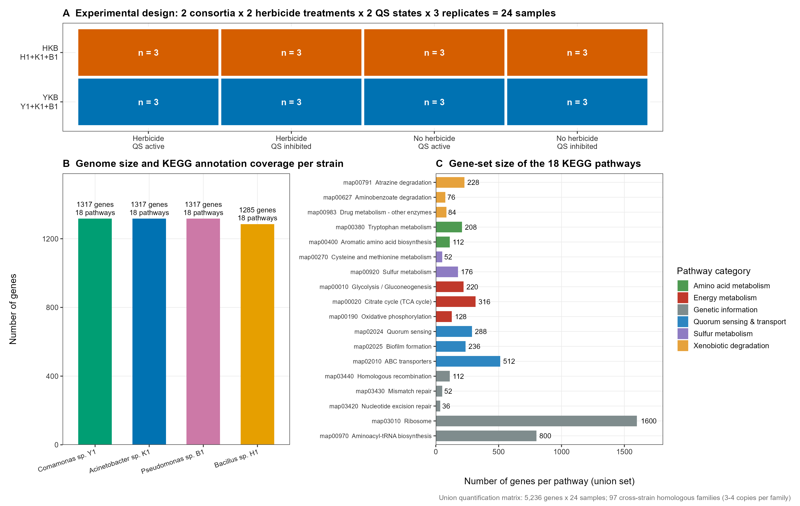

*图 1：2×2×2 设计矩阵（每格 n = 3）、四个菌株的基因组与 KEGG 注释覆盖、18 条通路的基因集规模。*

---

## 三、为什么非要分解

现在回到方法层面。

我们测的是**整锅汤**的转录组——一份 5236 基因 × 24 样本的混合矩阵。如果只是拿去算通路活性，得到的是"这锅汤整体在干什么"。

但我们要问的是"**谁**在干什么"。

这时候，如果直接把群落矩阵扔进 GSVA，得到的信号是所有成员叠在一起的加权平均。K1 上调了降解基因、B1 同时下调了同一个通路——两者一抵消，你什么都看不见。

所以必须拆。用上一篇讲的 DNMF：

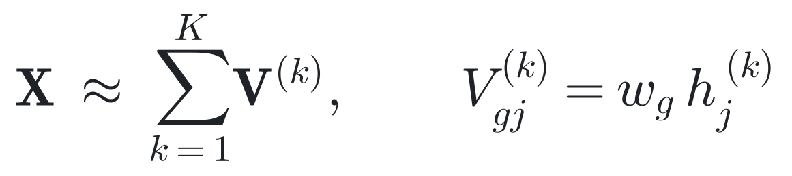

拆完之后，一份混合样本变成了**五套数据**：1 套群落层 + 4 套菌株层。每套都可以独立做 GSVA、独立做差异分析。

拆得准不准，得先验一遍。我们做了三重校验，结果如下：

| 校验项 | 结果 | 判读 |
|---|---|---|
| 四矩阵可回加 | 逐基因 <i>r</i> = 0.870，Σ菌株/Σ群落 = **1.000** | 保留了基因间的相对表达模式，且尺度已归一到群落总量 |
| 非成员识别 | 非成员丰度系数系统性偏低 | 没有凭空"创造"成员 |
| 重建残差 | Y1 0.760 / K1 0.784 / B1 0.754 / H1 0.761 | 归一化后每株只承担约 1/4 总量，残差必然放大，仅宜横向比较 |

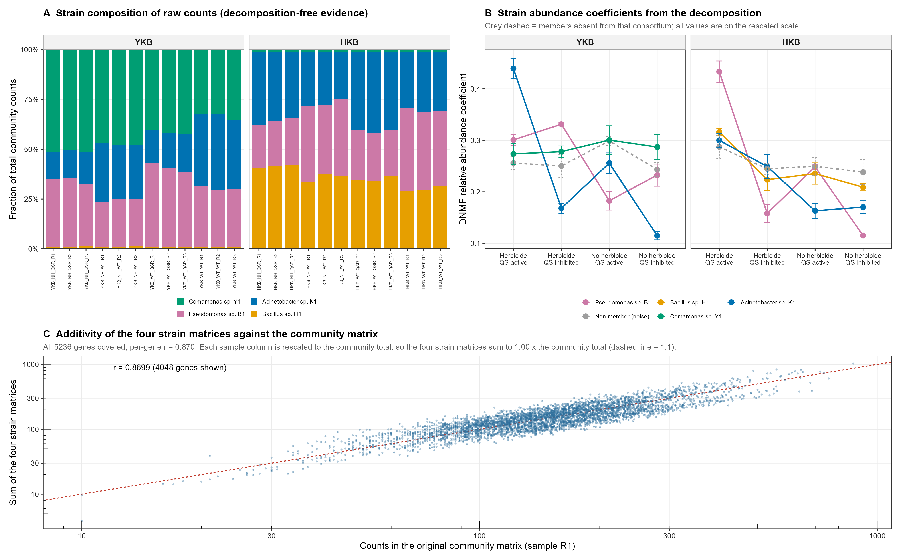

*图 2：分解质量的三重校验。(A) 原始 counts 的菌株构成；(B) 分解得到的丰度系数；(C) 四矩阵之和与群落总量的逐基因比较，散点已回到 1:1 线上。*

这里有个坑值得单独说：**GSVA 得分不能相加**。

我们试过把菌株层的得分按丰度加权求和，去逼近群落层的实测值——结果相关系数只有 **<i>r</i> = 0.28**，符号一致率 57%。基本等于瞎猜。

原因很朴素：GSVA 是**秩统计量**。它在单个样本内部对全转录组排序，本身就是个非线性操作。你先分解再打分，和先打分再分解，结果不可能一致。

所以"分层 GSVA"不是可选项，是必需品。想省这一步的人，最后都会在数据面前碰壁。

---

## 四、第一幕：QS 才是总开关

拆开之后，第一件事是看谁在驱动通路活性的变化。

先看全景。18 条通路在 24 个样本上的活性谱如下——两个菌群在异生物质降解三联通路上呈现近乎相反的整体水平，而 QS 相关通路与能量代谢则随处理条件移动。

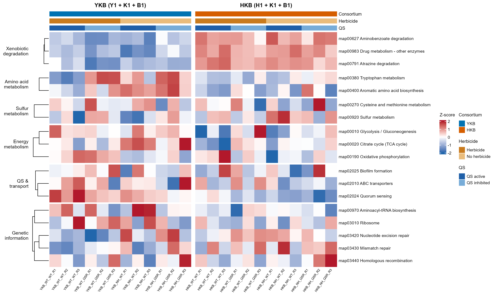

*图 3：群落水平 18 条 KEGG 通路的活性谱（行内 Z 分数）。列注释为菌群 / 除草剂 / QS 三种设计因子。*

肉眼看热图只能得到"有差异"，要定量就得上模型。我们做了 2×2 双因素方差分析（比逐格 t 检验有检验力得多），把三种效应拆开算：

| 效应 | 达到 <i>p</i> < 0.05 的"菌群×通路"组合 | 通过 BH 校正 | 涉及通路数 |
|---|---|---|---|
| **QS 状态** | 11 | **3** | 8 |
| 除草剂处理 | 6 | **0** | 5 |
| 除草剂 × QS 交互 | 5 | 1 | 5 |

看清楚这张表：**除草剂自己，一个都没通过校正**。而 QS 状态有 3 个稳稳过线。

那 3 个是谁？全在 YKB：

| 通路 | 生物学含义 | YKB η² | YKB <i>p</i> | YKB padj | HKB η² | HKB <i>p</i> | HKB padj |
|---|---|---|---|---|---|---|---|
| `map00380` | 色氨酸代谢 | **0.620** | 5.4e-4 | **0.010** | 0.204 | 0.15 | 0.355 |
| `map00791` | 阿特拉津降解 | **0.475** | 2.9e-3 | **0.026** | 0.561 | 8.3e-3 | 0.077 |
| `map02024` | 群体感应 | **0.451** | 4.5e-3 | **0.027** | 0.266 | 1.9e-2 | 0.115 |
| `map00920` | 硫代谢 | 0.510 | 1.8e-2 | 0.078 | 0.204 | 0.12 | 0.355 |
| `map00020` | TCA 循环 | 0.015 | 0.62 | 0.744 | 0.447 | 8.5e-3 | 0.077 |
| `map00983` | 药物代谢-其他酶 | 0.209 | 2.2e-2 | 0.078 | 0.407 | 3.6e-2 | 0.128 |

η² 是"这个因子占总平方和的份额"。`map00380` 的 0.620 意味着：色氨酸代谢这条通路 62% 的变异，能由 QS 状态单独解释——这在转录组数据里是个相当霸道的数字。

用人话说：**在这套体系里，决定"工厂开不开工"的是通讯状态，而不是有没有活儿干**。

这个结论乍一听有点反直觉——毕竟我们研究的是降解除草剂，直觉上除草剂才是主角。但数据不讲情面。

把六条关键通路的四条件分布摊开看，会更直观：

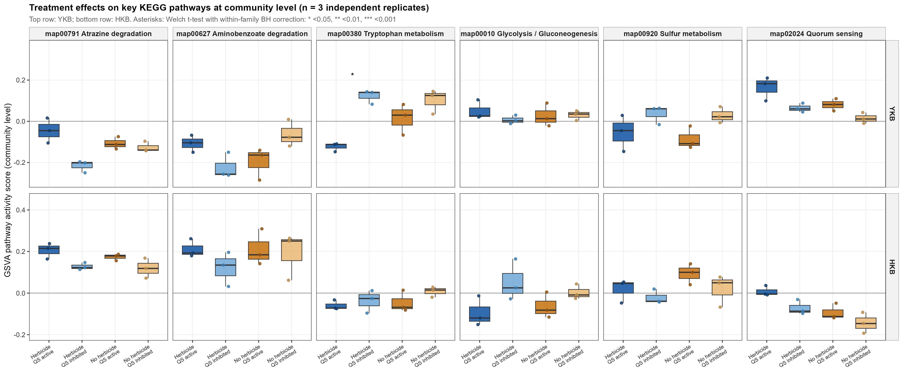

*图 4：群落水平 6 条关键通路的四条件分布（n = 3）。上排 YKB、下排 HKB；星号为 Welch t 检验、族内 BH 校正后 padj < 0.05 的对比。*

注意图 4 里的星号非常少——逐格 t 检验在 n = 3 时检验力有限，整个群落层只有 `map00380` 一项通过了校正。这恰恰说明：**2×2 设计应当用主效应模型，而不是逐格比较**。样本量不够的时候，把数据拆成四格分别比，是在浪费统计功效。

---

## 五、第二幕：一个漂亮的"门控"现象

如果故事到这儿就结束，那不过是"QS 很重要"这种老生常谈。真正有意思的，是交互项。

先看效果量的全景。图 5 把"处理 − 对照"的差值按通路铺开，左半是除草剂效应，右半是 QS 效应：

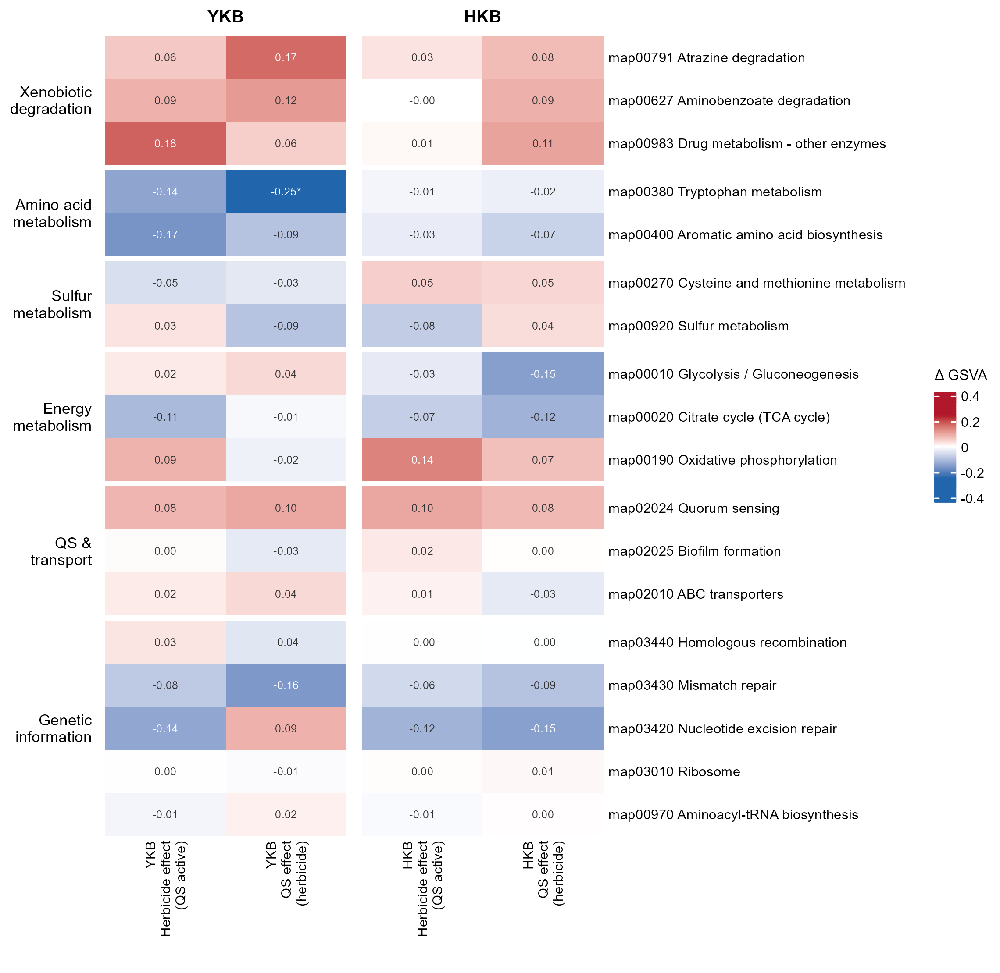

*图 5：群落水平的处理效应 Δ。左侧为除草剂效应，右侧为 QS 效应。除草剂效应整体色浅（|Δ| 多在 0.1 以内），QS 效应明显更强。*

视觉上已经很明显了：**左边一片淡，右边一片浓**。这跟方差分析的结论完全咬合——除草剂在群落层几乎没有可复现的效应。

但"几乎没有"不等于"完全没有"。看 `map00791`（阿特拉津降解）这条通路，它的除草剂效应**取决于 QS 状态**：

- QS 正常时，加除草剂，通路活性 **+0.062**（微微上调，符合预期）
- QS 被抑制时，加除草剂，通路活性 **−0.090**（反而下降！）

**方向被翻转了。**

这个翻转在统计上是站得住的：交互项 <i>p</i> = 0.0099，逐格检验 <i>p</i> = 0.017。但要诚实地说，交互项的 BH 校正后 <i>p</i> = 0.059，卡在阈值边缘——所以我们在论文里把它写成**强假说**，而不是确证结论。

顺便说，交互效应在群落层一共 5 个组合达到 <i>p</i> < 0.05，但只有 `map00983` 通过了校正（padj = 0.030）。`map00791` 和 `map00627` 的 padj 都停在 0.059。这不是"没效应"，而是"证据强度还没到能拍板的程度"。

机制上怎么解释？

除草剂对细菌来说是一个"有毒信号"。要把它从信号转化为"启动降解操纵子"的行动，需要经过 QS 回路这道关卡（很可能是 LuxR 型调控子）。信号链断了之后，除草剂就只剩毒性，没有诱导收益——细菌不但不加班，还会因为中毒而整体下调代谢。

**这就是"门控"（gating）**：不是除草剂直接指挥降解，而是 QS 决定"要不要听除草剂的指挥"。

这个假说是可检验的：在 Δ<i>luxI</i> 或 <i>luxR</i> 突变背景下重复除草剂处理，如果诱导消失，门控就成立。

---

## 六、第三幕：一张会换人的排班表

接下来是最有信息量的部分——菌株层。

先把四个菌株矩阵分别打分，铺成一张热图。左边是群落参照，右边三列是各成员的得分：

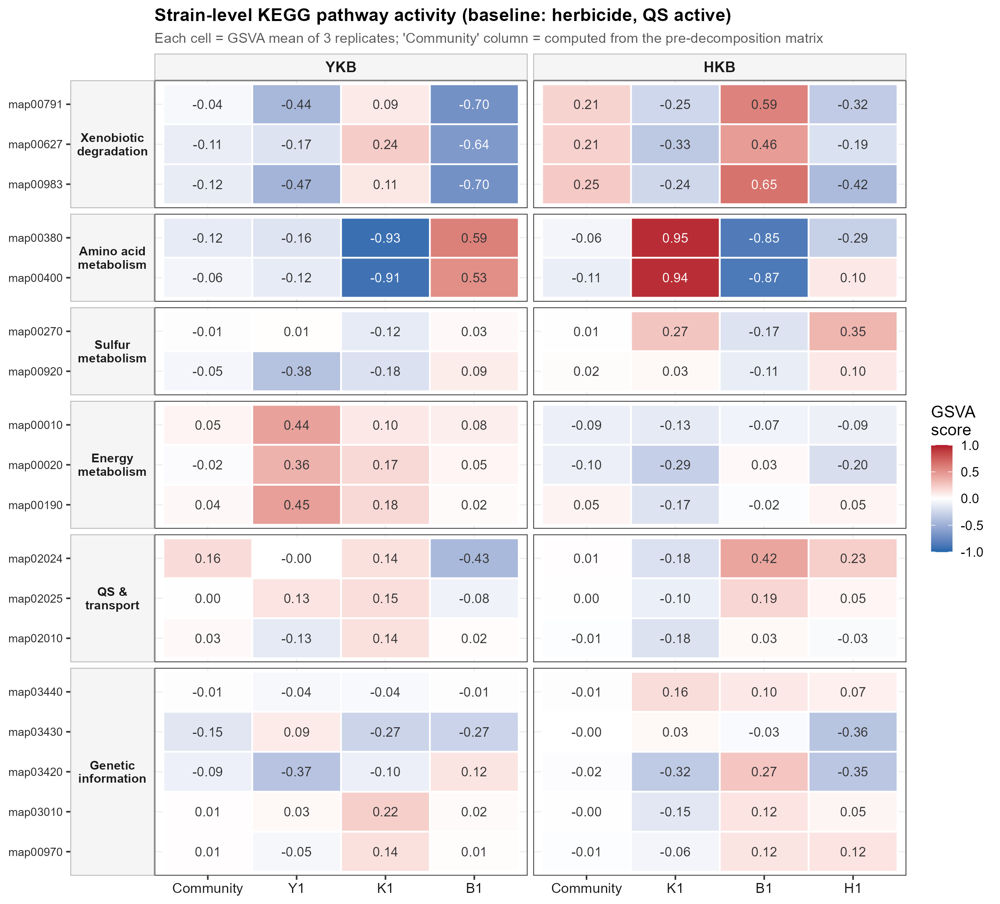

*图 6：菌株水平 18 条通路的活性（基准状态：除草剂 + QS 正常）。"Community" 列为分解前总矩阵直接算出的参照值。*

一眼就能看出：**这不是平均分担，而是各占一块**。异生物质降解、色氨酸代谢、能量代谢三条主线，各自被单一菌株占据。

把关键通路的具体数值列出来：

| 通路 | YKB: Y1 | YKB: K1 | YKB: B1 | HKB: K1 | HKB: B1 | HKB: H1 |
|---|---|---|---|---|---|---|
| `map00791` 阿特拉津降解 | −0.44 | **+0.09** | −0.70 | −0.25 | **+0.59** | −0.32 |
| `map00627` 芳香族降解 | −0.17 | **+0.24** | −0.64 | −0.33 | **+0.46** | −0.19 |
| `map00380` 色氨酸代谢 | −0.16 | −0.93 | **+0.59** | **+0.95** | −0.85 | −0.29 |
| `map00400` 芳香族氨基酸合成 | −0.12 | −0.91 | **+0.53** | **+0.94** | −0.87 | +0.10 |
| `map00010` 糖酵解 | **+0.44** | +0.10 | +0.08 | −0.13 | −0.07 | −0.09 |
| `map00920` 硫代谢 | −0.38 | −0.18 | **+0.09** | +0.03 | −0.11 | **+0.10** |
| `map02024` 群体感应 | −0.00 | **+0.14** | −0.43 | −0.18 | **+0.42** | +0.23 |

加粗的是该群落的最高分。看出问题了吗？

**K1 和 B1 在两个群落里，把角色对调了。**

在 YKB 里，K1 是降解担当（+0.09），B1 管色氨酸（+0.59）；到了 HKB，B1 成了降解担当（+0.59），K1 去管色氨酸（+0.95）。两个人换了工位，但"降解 + 氨基酸供给"这两个岗位始终有人站着。

这不是巧合。它说明群落有**功能冗余 + 角色可塑性**：岗位是固定的，坐的人可以换。这也解释了为什么两个群落都能高效降解——成员换了，功能位没塌。

然后我们把 QS 开关按下去，看排班表怎么变。菌株层的效果量热图如下：

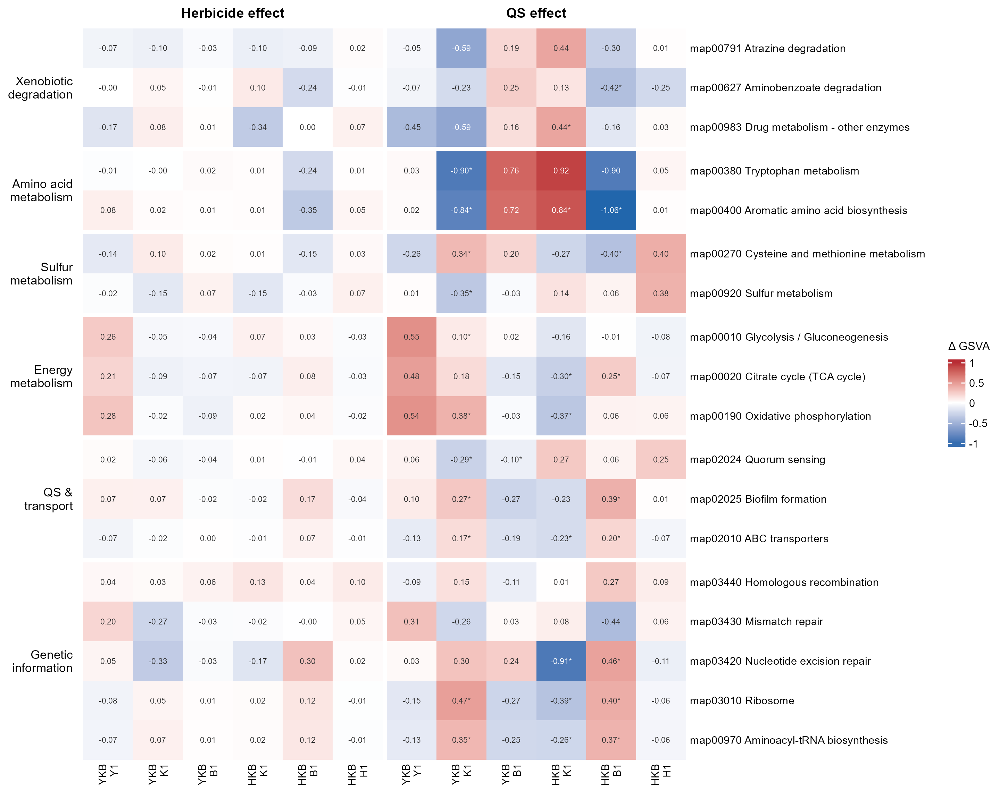

*图 7：菌株水平的处理效应 Δ。每列为一个"菌群 × 菌株"。除草剂效应（左块）在所有菌株上都很弱；QS 效应（右块）则出现大幅度的正负翻转。*

左块（除草剂）几乎是一片白——216 个菌株层除草剂对比里，通过校正的是 **0 个**。右块（QS）则是大片深红深蓝，最大的 |Δ| 到了 1.11。

**同一通路在不同菌株上被同时"打开"和"关闭"**，这是分工重排的直接证据。

具体看芳香族氨基酸的交接，方向在两个群落里**恰好相反**：

| 群落 | 菌株 | `map00380` 色氨酸 | `map00400` 芳香族氨基酸合成 | 生态学读法 |
|---|---|---|---|---|
| HKB | B1 | −0.90 | **−1.06**（padj = 0.001） | 原"制造者"停产 |
| HKB | K1 | +0.92 | +0.84 | "替补"接管 |
| YKB | K1 | −0.90 | −0.84 | 原"降解者"停产 |
| YKB | B1 | +0.76 | +0.72 | 向 B1 反向交接 |

同一时刻，YKB 里 K1 的降解通路也同步下滑（`map00791` Δ = −0.59、`map00983` Δ = −0.59）。

**QS 回路扮演的是"调度开关"的角色，而具体的调度方案，由队伍里有谁决定。**

这句话是整篇文章的核心。

---

## 七、第四幕：基因层面的"谁都能干"与"非他不可"

通路层看的是"哪个部门在动"，基因家族层能看得更细。

我们有 97 个跨菌株同源家族，每个家族在 3–4 个菌株里各有一份拷贝。先看整体的表达偏好：

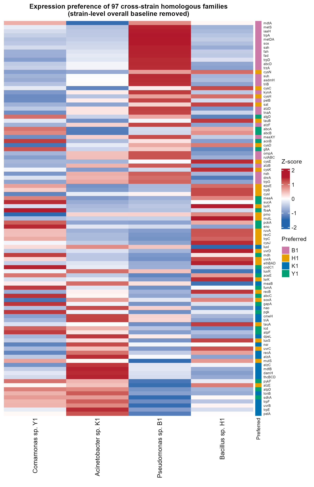

*图 8：97 个同源家族的表达偏好（已扣除菌株整体表达基线）。右侧色条标注该家族的相对偏好菌株。*

热图有明显结构：上段（`trpA`/`trpD`、`metDA`/`metS`、`fad`/`fah`、`trzA`）强烈偏向 B1；下段偏向 K1（`mdtB`、`thcBCD`、`trpE`）与 Y1（`pykF`、`atpD`、`sdhA`）。**是模块化的偏斜，不是随机分布。**

对每个家族，算一个**专一性指数**：

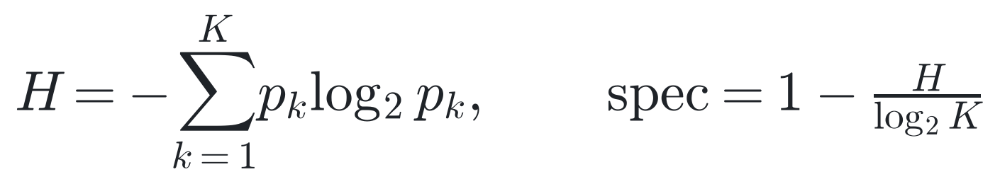

<i>pk</i> 是第 <i>k</i> 个菌株在该家族中的份额，<i>H</i> 是香农熵，<i>spec</i> = 0 表示四菌均分，= 1 表示被单菌独占。

**先说冗余的那一半。**

阿特拉津降解的九个家族（`atzA`–`atzF`、`trzA`、`triA/B`），四个菌株的相对贡献全部落在 **0.15–0.41** 之间，没有任何一个成员低于 15%：

| 家族 | Y1 | K1 | B1 | H1 | spec |
|---|---|---|---|---|---|
| `atzA` | 0.229 | 0.272 | 0.284 | 0.215 | 0.005 |
| `atzB` | 0.205 | 0.267 | 0.338 | 0.190 | 0.019 |
| `atzC` | 0.193 | 0.303 | 0.275 | 0.228 | 0.011 |
| `atzD` | 0.196 | 0.259 | **0.398** | 0.147 | 0.049 |
| `atzE` | 0.241 | 0.257 | 0.239 | 0.262 | 0.001 |
| `atzF` | 0.169 | 0.273 | **0.411** | 0.148 | 0.060 |
| `trzA` | 0.205 | 0.236 | **0.395** | 0.164 | 0.041 |
| `triA` | 0.180 | **0.352** | 0.311 | 0.158 | 0.040 |
| `triB` | 0.192 | 0.245 | **0.399** | 0.164 | 0.045 |

这意味着什么？**每个成员都带着完整的降解基因盒，而且都在表达。**

所以从群落层面看，除草剂想通过"干掉某一个成员"来瘫痪降解功能，是徒劳的——只要还有一个在，降解潜力就不会归零。这就是冗余的生态学价值。

当然，份额并不平均。B1 在 `atzD`、`atzF`、`trzA`、`triB` 上稳定占优（0.395–0.411），K1 在 `triA` 上领先（0.352）。**冗余不等于均摊。**

**再说非冗余的那一半——这才是真正的发现。**

信号系统的家族，画风完全不同：

| 家族 | Y1 | K1 | B1 | H1 | spec |
|---|---|---|---|---|---|
| `luxI`（AHL 合成酶） | 0.276 | **0.371** | 0.353 | **0.000** | **0.213** |
| `luxR`（AHL 受体） | 0.216 | **0.420** | 0.364 | **0.000** | **0.233** |
| `luxS`（AI-2 合成酶） | 0.189 | 0.266 | 0.174 | **0.371** | 0.034 |

三件事：

1. **`luxI` / `luxR` 在 H1 中完全缺失**（份额精确为 0，不是"很低"，是零）。
2. `luxS` 则四菌齐备，而且在 H1 中反而最高（0.371）。
3. 三条家族的专一性差了近一个数量级：`luxR` 的 0.233 是全家族最高的一档，而 `luxS` 只有 0.034。

这就解释了为什么 QS 干预的效果，在两个群落里不一样大。

**AHL 通道是个"单点"**：它依赖 K1 和 B1，而这两人恰好是两个群落的共享成员。所以 AHL 一旦被掐，影响是全局的。

**AI-2 通道则四通八达**：连 H1 都能生产。所以掐 AI-2，效果更依赖具体组成。

而 H1 是革兰阳性菌（*Bacillus*），本来就不玩 AHL 那套（LuxI/LuxR 系统主要是革兰阴性菌的语言）。HKB 里多了个"说另一种语言"的成员，通讯格局自然从"种内 AHL"转向"跨种 AI-2"。

**基因层的缺失，直接翻译成了生态层的通讯策略差异。** 这是我在这套数据里最喜欢的一条证据链。

最后，把这些组成信息压到基因维度上，得到一张"每个基因属于谁"的散点图：

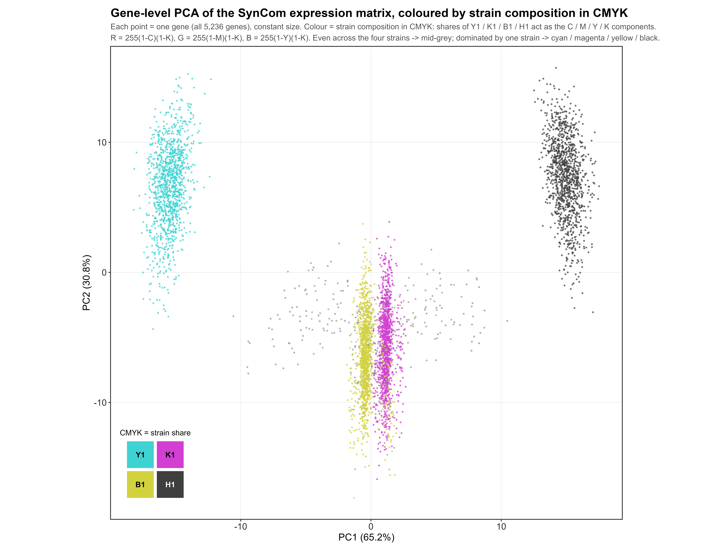

*图 9：全部 5 236 个基因的 PCA，点大小固定，颜色为四菌组成的 CMYK 编码（Y1/K1/B1/H1 分别作为 C/M/Y/K 分量）。四菌均分 → 中灰，偏向单菌 → 青/品红/黄/深灰。*

青色簇是 Y1 特有基因、深灰簇是 H1 特有基因，中间的暖黄与品红是 B1 与 K1——位置和颜色互相印证。而散布在三个模块之间过渡带的那些灰褐色点，正是四菌份额接近均分的同源家族基因。**颜色本身就在说：这些基因不由单一菌株承担。**

---

## 八、把机制串起来

现在可以把四幕拼成一个模型了。

**第一步：冗余的基因库 → 抗扰动。**
九个降解家族在四菌间广泛分布，谁都能干。所以除草剂处理在群落层几乎测不到剧烈的通路变化——不是没响应，是响应被冗余稀释了。

**第二步：不冗余的信号系统 → 高杠杆调控点。**
`luxI`/`luxR` 在 H1 中缺失（份额为 0），只在 Y1、K1、B1 中存在。QS 因此成为整个群落的"单点故障"，一旦被干预，所有成员的分工方案同时被改写。

**第三步：QS 门控除草剂信号。**
除草剂的诱导作用需要经由 QS 回路才能兑现。信号链一断，除草剂从"开工令"变成"毒药"。

**第四步：分工可互换，功能位保守。**
K1 与 B1 在 YKB/HKB 中互换角色，但"降解 + 氨基酸供给 + 中心碳代谢"三个岗位始终有人。这是群落能容忍成员替换的生态学基础。

**第五步：能量代谢是最不冗余的一环。**
YKB 的糖酵解几乎完全由 Y1 承担（+0.44，其余两菌接近 0）。HKB 里没有 Y1，三条能量通路在群落层整体转负（`map00010`：YKB +0.05 vs HKB −0.09）——缺了这个"发电厂"，整个群落的中心碳代谢都矮了一截。

**冗余有边界。** 降解基因可以冗余，信号系统不能，中心碳代谢也不能。这个"冗余梯度"，决定了群落在面对不同类型扰动时的脆弱点在哪里。

---

## 九、如果只让我说一句方法论上的话

这套分析之所以能做出上面这些结论，全靠一件事：**我们在不丢失生物学信息的前提下，把一份混合样本拆成了多套可独立分析的数据**。

传统做法要么是：
- **只做群落层**（便宜，但看不见分工），要么
- **拆菌、纯培养、分别测**（准确，但那就不是群落了，互作全丢）。

DNMF 给的是第三条路：

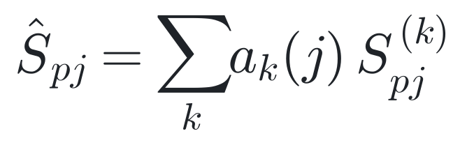

群落层的信号，可以表示成各成员活性按丰度加权之和。下图把这层关系画了出来——彩色堆叠条是重构值，黑色竖线是实测值：

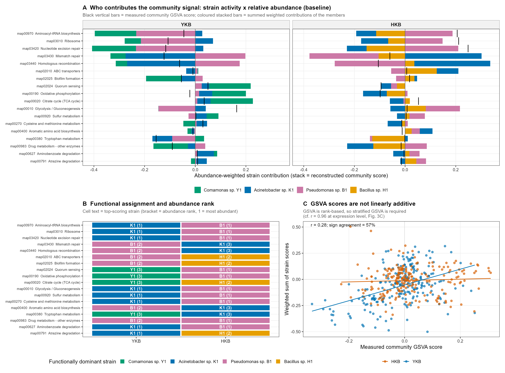

*图 10：菌株贡献、功能归属与加和性提示。(A) 按"菌株活性 × 相对丰度"重构的群落信号与实测值对照；(B) 每条通路得分最高的菌株及其丰度位次；(C) GSVA 得分不可线性加和。*

这意味着同一个实验，既能回答"整体怎么样"，也能回答"谁在起作用"——**用同一批测序数据**。

成本上，这是数量级的差别；科学上，它让"分工"从一个比喻，变成了一个可测量的量。

---

## 十、几盆冷水

吹完了，说点不好听的。

**1. 分解质量没有 ground truth。**
我们做了三重校验：非成员丰度是否贴噪声、四矩阵能否回加（<i>r</i> = 0.870，比值 1.000）、菌株排序与基因集平均表达是否一致（代谢类通路 85% 一致）。这些都是**间接旁证**，能提高信心，但不能证明。
要做绝对验证，得上 qPCR、分箱宏基因组或者单菌转录组。

**2. 有些结论只是"强假说"。**
比如前面那个"QS 门控"——交互项 <i>p</i> = 0.0099，但 BH 校正后 0.059。方向明确、两项独立检验一致，但强度卡在阈值边缘。我们在文章里说得很克制，也建议了验证实验。

**3. 转录组是"想做什么"，不是"做了什么"。**
mRNA 丰度和蛋白丰度、酶活之间隔着一层翻译调控。这篇里所有结论都停在转录层，"降解能力"的最终确认还得靠化学分析（降解率、代谢产物）。

**4. 样本量。**
n = 3。逐格 t 检验的检验力有限——216 个菌株层除草剂对比里，通过校正的是 **0 个**。所以我们的主要结论都建立在双因素主效应模型上，而不是逐格比较。这个取舍要说清楚。

**5. 实验室里的群落，不是地里的群落。**
1:1:1 接种、100 mg/L 除草剂、恒温摇床——这些条件在黑土地里一个都不成立。SynCom 的价值在于**机制可控**，但把它直接外推到田间，中间还隔着一整个生态学。

---

## 尾声

回到开头那个问题：这四位怎么协调的？

现在的答案大概是：

> 它们靠化学信号排班。信号在，除草剂是开工令；信号断了，除草剂就是毒药。
> 岗位是固定的，但坐的人可以换。
> 唯一不能缺的，是那个发号施令的人。

至于这个答案能不能帮我们把菌群真正用进黑土地里——那是下一个研究的问题了。

---

*数据与代码：5 236 基因 × 24 样本，DNMF 四因子分解，18 条 KEGG 通路的 GSVA 评估。文中所有数值均来自本次分析的输出结果（`results/` 与 `key_findings.txt`），图件见 `figures/`，全部分析脚本可复现。*
